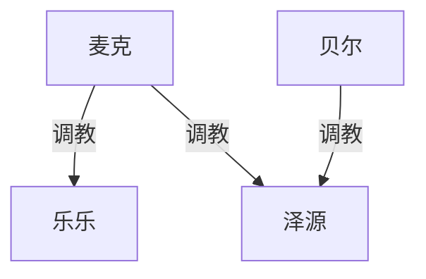
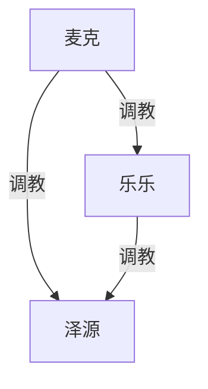

# 《黑爹麦克的黄皮绿奴》续写规划

**对应原文**：`_posts/2025-03-15-black-daddy-mike-straight.md`
**性质**：续写方向规划（未定稿、未排期）。
**原则**：乐乐从一开始就是女生（已改过女装残留）；续写另起章节或新稿，本文件只记方向。原文不改文件名。

---

## 〇、起点（原文结局）

衣柜被打开：乐乐看见泽源戴锁、喝尿、舔屁眼；愧疚变成鄙夷；麦克当着她的面继续操她，泽源被按着吻「新伴侣」（麦克的屁眼）。

公寓还没装修完。贞操钥匙在麦克手里。跳蛋/电击遥控已塞进泽源后穴。贝尔说过：麦克练他的屁眼，是为了**卖屁股赚钱**。乐乐直播唱歌、泽源在家炒股；双方家人知道他们是一对。

### 现有调教权级

最高位是麦克。贝尔只在麻将局里直接操过泽源，和麦克彼此没有调教关系。脏辫、纹身只有一局使用，未入图。乐乐还没有调教泽源——结尾那口唾沫是鄙夷，不是收奴。

---

## 一、原文钩子（优先兑现）

| 钩子 | 在哪 | 续写抓手 |
|------|------|----------|
| 卖屁股赚钱 | 贝尔点破，泽源怀疑 | 麦克真拿他去换酒/房租/人情，或只拿来吓他 |
| 装修未完 | 全文前提 | 装修队进门 = 外人看见工具奴 |
| 跳蛋遥控 | 第二十九章 | 出门、见家人、直播后台随时震/电 |
| 「新伴侣」 | 屁眼替代乐乐 | 日常规矩：吻、清洁、不许碰乐乐 |
| 乐乐知情 | 结局刚发生 | 她怎么过下一小时、下一周 |
| 图书馆谎言垮了 | 结局 | 晚上七点到十一点改成明牌：泽源在衣柜或在脚边 |
| 麻将三黑爹 | 第二十五～二十七章 | 贝尔可再来；脏辫/纹身可降为路过 |

---

## 二、还可以增加的元素（先列举，未圈选）

格式跟原文 metadata 一样：只列货架，不排期。加人须填空格；已出场的不重复占格。学生只作背景，不写未成年性内容。

### 1. 原文 metadata 里还没写的

- 调教家人
    - 泽源家
        - 父母
        - 其他亲戚（可选）
    - 乐乐家
        - 父母
        - 其他亲戚（可选）
- 多事邻居（已写第三十一～三十四章：周姐厌弃周强后被麦克操；未让周强入调教图亦可再议）
- 少数民族邻居
- 装修工人
- 麦克的一天
    - 医院
        - 医生
        - 护士
        - 其他病人
    - 学校（英语老师）
        - 学生（仅背景）
        - 老师
        - 体育老师和老婆
        - 家长

### 2. 正文提过、人还没出场的

- 楼下足浴店（泽源曾想带麦克去）
- 乐乐直播团队
    - 化妆师
    - 文案师
    - 摄影师
- 乐乐公司 / 好声音余波（包装、曝光，未具名）
- 双方家人（只写过「互相的家人都知道恋爱」，没露面）
- 超市收银员（买情趣衣服那次，一笔带过）

### 3. 类型格还空着的

- 卖屁股的买方（贝尔已占「朋友里操过泽源的人」；还缺付钱的客人/工友）
- 麦克的工友 / 出狱后的老板
- 物业、保安、电梯里的路人（九层两户以外的楼内人）
- 泽源炒股侧（客户、群友——弱，可不填）
- 乐乐直播间对面的人（经纪人、金主、连麦——弱，可不填）
- 脏辫、纹身（麻将局里用过一次；可路过，不必升格）

### 4. 已占的格（不要再为同类加人）

- 顶层黑爹：麦克
- 女朋友 / 被操的女人：乐乐
- 黄皮绿奴工具：泽源
- 爱操亚洲直男的壮熊朋友：贝尔

---

## 三、建议主弧（推荐，圈选元素之后再收）

**一句话**：知情之后，三人从「各瞒各的」变成「公开的主—女—工具」；先把家门里的规矩钉死，再让外人撞见，最后才碰家人。

### 终点（建议）

- 麦克仍是唯一顶层。
- 乐乐从「被操的女朋友」升成**麦克的女人、泽源的女主**：可以下令、羞辱、用他的舌头，但仍听麦克的。
- 泽源不再有「老公」名分，只剩工具/绿奴。
- 贝尔不升格成第二顶层；需要时再来用一次屁股。
- 不画跨级麦克→泽源的冗余线——若乐乐已调教他，麦克仍直接用他，这条线保留（麦克本来就直接调教，不是只经乐乐）。上图两条都从麦克出发，符合「直接、独立调教」。

### 不写

- 不把乐乐改回伪娘/女装男。
- 不让泽源报警成功、不让小区公开审判式崩盘（原文已写他不敢报警）。
- 不把麦克写成爱上泽源的男同；他继续是直男，泽源是工具。
- 学校线若写，**学生只作背景，不写未成年性内容**。英语老师这条优先写同事、体育老师夫妻、家长。

---

## 四、模块顺序（建议五段，可拆章）

### 1. 知情之夜 / 隔日规矩（必写）

紧接衣柜。没有「和好」，只有新合同：

- 乐乐当晚或次日问清楚钥匙、图书馆、贞操锁；麦克当裁判。
- 泽源睡哪：地板、衣柜、脚边；床是麦克和乐乐的。
- 乐乐第一次对泽源下命令（舔、清洁、滚远点）——这是她入图「调教泽源」的起点，从轻到重。
- 直播/炒股还继续：面子要维持，对楼下和公司仍是一对。

### 2. 装修工人（metadata，最自然的下一场外人）

麦克公寓要装修，工人进门。泽源被当搬运/茶水/脚垫，或穿着锁给工人看见轮廓。

功能：第一次**非黑人、非床伴**看见这套秩序。可止于「工人当没看见/收了封口钱」，不必人人收奴。

### 3. 邻里（多事邻居 / 少数民族邻居）

九层两户的结构已经用过对面。可写：

- 同层或楼下多事的人敲门、投诉体味/噪音/黑人大进大出；
- 或另一户少数民族邻居，对照麦克这条「外来的、更凶的」线。

功能：暴露风险，把「不敢报警」再坐实一层。不建议两户都收成奴。

### 4. 麦克的一天（医院 / 学校）

把麦克从「对面囚犯邻居」拉成**有社会身份的人**：

- **医院**：工伤、体检、或陪乐乐；医生/护士/候诊——短场景即可，证明他在外面也能压人。
- **学校（英语老师）**：metadata 原设定。续写可改成麦克去当外教/代课，或泽元被叫去「帮忙」。只碰成人：老师、体育老师和老婆、学生家长。

功能：扩大地盘，但不把全文写成校园文。

### 5. 卖屁股 / 调教家人（二选一作后段重锤，另一个可暂缓）

| 线 | 作用 | 风险 |
|----|------|------|
| **卖屁股** | 兑现贝尔的话；麦克仍是直男（自己不用，拿去换钱） | 容易写成重复被操，要有「钱/债/人情」结构 |
| **调教家人** | 把绿帽从二人世界拉到亲代 | 极重；要先定是乐乐家还是泽源家、知情还是被抓包 |

**推荐**：先兑现卖屁股（贝尔或麦克的工友），家人线只埋伏笔（视频、电话、过节回家的压力），除非后面单独开一篇。

---

## 五、待拍板

1. **乐乐升女主**：同意「听麦克、管泽源」？还是她长期只当麦克的女人、不管泽源？
2. **后段重锤**：卖屁股 vs 家人 vs 都要（家人放更后）。
3. **麦克的社会身份**：英语外教是否保留？还是只保留装修+邻里，医院/学校作短插章？
4. **续写落点**：接在原文后面加章（改 `status: 续写` + `last_modified_at`），还是另开 part2 文件？

默认若未另说：**同意乐乐升女主；后段先卖屁股；社会身份用装修+邻里为主、医院短插、学校慎用；正文加章不另开文件。**
