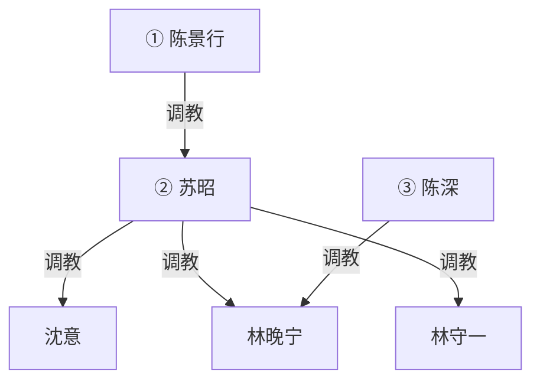

# 《霸凌者的孩子》规划

**性质**：新稿方向规划（未定稿、未排期、不上线）。
**对应文件名（若写）**：`_posts/YYYY-MM-DD-bully-victim-children-marriage.md`
**暂定标题**：`"霸凌者的孩子"`（可改 `"谈婚论嫁"`、`"同事的妈妈"`）。
**原则**：
- **上一代**：**女主女奴**（苏昭收沈意）。大学校园霸凌（全员已成年）。只写大学。
- **陈家**：**丈夫更强势**。苏昭靠校花身份嫁给有权有势的高富帅陈景行。家里他压她；她对沈意仍是女主。
- **这一代**：**男主女奴**。陈深、林晚宁约二十五岁，**工作后认识**。在一起不久，陈深就开始欺负她，当婢女、性奴用。不是处了一年才收。
- **夫妻不同姓**：女方婚后不改姓。陈景行 × 苏昭；林守一 × 沈意；陈深 × 林晚宁。子女随父姓。
- 权级同向：陈家在上，林家在下。不翻案。不跟 `in-laws.md` 抢彩礼/舅舅线。

---

## 〇、一句话

大学里校花苏昭把同班沈意踩成狗，毕业靠这张脸嫁进陈家，丈夫陈景行有权有势、比她更强。二十多年后，他们的儿子陈深在公司里追求沈意的女儿林晚宁。在一起不久，他就开始欺负她，把她当婢女和性奴。二十五岁上下，要见家长谈婚。苏昭认出沈意。

---

## 一、为什么值得写（和已有稿的差）

| 已有 | 差在哪 |
|------|--------|
| `in-laws.md` | 彩礼、舅舅控场。本篇发动机是认人。钱和房子由陈景行随口定，不写成要彩礼大战。 |
| `daughters-boyfriend.md` | 爹看女儿男友。本篇是**双方母亲都有旧账**，陈深这一代自己已是男主，父亲比母亲更强。 |
| 林宇校园帝国 | 校园只在父母代大学。 |
| `mrs-zhao.md` / 女 S 当家 | 苏昭对外、对沈意是女主，**在自己家里不是最高位**。 |

不选「受害者发迹」。也不选苏昭家里再养一个窝囊丈夫——那条已经否掉。

---

## 二、人物介绍

六人。删掉旧设定里的家奴丈夫陈建平。不写第三家、舅舅、老师。

### 关系（见面之前）

- 陈景行 ↔ 苏昭：夫妻。他调教她。她是校花妻子，不是对外的女主人压过丈夫。
- 沈意 ↔ 林守一：夫妻。**林家内部没有调教权级**。她没把大学的事告诉他。两人都软，不是女主男奴，也不是他压她。
- 陈深 ↔ 林晚宁：同事，刚在一起。确认恋爱不到两个月，他就开始欺负她：家务婢女、性奴。她还来不及习惯，已经在跪。
- 苏昭 与 沈意：大学旧主奴，断了二十多年。两边孩子都不知道。陈景行也不知道这段，除非苏昭当笑话提过「大学有个贱人」而不提姓名。
- 陈景行 与 陈深：父子。家规、事业、怎么对人，父亲说了算。**不画父子性奴**。
- 苏昭 与 陈深：母子。教他带人、教他养女人，不拿儿子当奴。

### 陈景行（男，四十八）——陈家最高位

有权有势的高富帅。脸、身材、家底都压过大学那一届男生。不是苏昭的同学奴，是她毕业后嫁进去的那个人。公司或家里产业说了算（具体职务后定，正文点到即可）。

家里他更强势：规矩、钱、性、苏昭的面子，都由他定。苏昭靠校花身份进门，进门后是他的人。对外他们是体面夫妻；门一关，她听他的。

见林家之前，他不一定认得沈意。认人之后他可以下场，也可以让老婆表演旧规矩给他看——他喜欢看校花妻子把别的女人按在脚下，这不降低他压她。谈婚时房子、工作、住哪，他说了算。若他当面收过沈意、林晚宁或林守一，才画他指向林家；默认先画他调教苏昭，林家仍由苏昭开第一刀。

### 苏昭（女，四十七）——上一代女主（陈家次级）

大学校花，班里带头的人。漂亮，会带人，不讲理。毕业靠校花身份嫁给陈景行，进陈家当太太，姓仍是苏。现在保养得好，对外是陈太太苏昭；在丈夫面前收着，对沈意仍是旧主。

大学时收过沈意：跑腿、罚跪、当众踩、舔鞋、口交、宿舍椅垫、当众羞辱。倒叙里帮凶是别的女生或围观，**不是现在的丈夫**。偶尔跟陈景行提大学有人跪过她，当炫耀校花岁月，没去找。

见面认出沈意之后，旧规矩当众使。沈意由她重新收。她不是全家最高位。林晚宁若她当面单独收过，才画她指向儿媳。

### 沈意（女，四十七）——上一代女奴

大学被校花苏昭按在最底下的女生。毕业后逃掉。安静、客气，邻里觉得温柔。嫁给更软的林守一，姓仍是沈。女儿林晚宁随父姓，像她。

家里她管柴米油盐，当不成主：谁一硬她就让，所以丈夫偶尔提高音量她先软，丈夫心软了她又把事情揽回来。大学那套她压着，不拿丈夫当奴，也不肯让丈夫拿她当奴——两边都像碰那块旧伤。见苏昭第一眼，身体先认。高潮场里当众做旧规矩。重新归苏昭。

### 林守一（男，四十八）

沈意的丈夫，林晚宁的爸。工薪，户主写他的名。想当好丈夫好爸爸，力气和脾气都不够。不喝酒打人，不在外面养人。护女儿是口头上的，真碰上硬的就鞠躬赔笑。

不知道妻子大学那段，也不知道女儿在陈深那儿跪。见家长前把陈深当「能干的男孩」，把高攀陈家当福气。看见妻子跪了之后崩溃，不是怒，是怕。入图从被收的那场起。默认苏昭先手。

### 林家内部（见面之前）

用来反衬陈家。陈家有主；林家和睦、没主。**图上不画林守一与沈意之间的边。**

- **钱**：普通工薪。他上班挣钱，她文员或家里为主（后定一种即可）。一套普通房，存款经不起陈景行随口一句话。见陈家会自卑，但他们把自卑说成客气。
- **谁当家**：名义他是户主，实际没人拍板。买菜、女儿衣服沈意定；换工作、买房、谈婚这种大事两个人互相看、互相推，最后拖到不能不答应。
- **吵架**：有，短，不大声。他先憋，她先软，再一起道歉。邻里觉得这家人好说话、不惹事。
- **性**：少，关灯，不命名。她偶尔会突然低头、跪到床边或把脸埋下去，他当她累了、害羞了，从没问过大学。不是女主，也不是他调教她。
- **女儿**：两人一起惯。晚宁小时候一哭就停，长大了报喜不报忧，他们把听话当成懂事。不知道她在外面跪、口、做家务奴。管教最多是「别太累」「对男朋友好一点」。
- **见陈家前的心理**：高攀。林守一预备鞠躬敬茶；沈意预备赔笑、称陈太太、把女儿往前送。没人预备自己会跪。林晚宁回家仍装刚谈恋爱、男朋友对她好，他们信。她不敢说自己已经在人家公寓里跪着擦地、口、被当性奴。

不写成：沈意在家当女 S 泄压；林守一家暴或酒后打人；林家先有一套夫妻奴。那会跟陈家撞，也分流认人那场。

### 陈深（男，二十五）——这一代男主

陈景行和苏昭的儿子。脸像爸，带人像妈。公司里岗位更靠前，有家里托底，不写职场发迹史。

工作后认识林晚宁。约会没几回就确认关系；**在一起不久就开始欺负她**：使唤、罚跪、家务当婢女，口和身体当性奴。不是温吞处一年再收。真心想要她，要的方式是占住、用够、再带回去见家长把人锁进陈家。不知道妈妈大学具体做过什么，这套欺负是自己开的，继承气场，不是继承家史。

见家长前过父母两关：父亲更吓人，母亲更难缠。认出之后不救林家。只直接调教林晚宁。不画他指向沈意，除非正文写他单独收岳母。

### 林晚宁（女，二十五）——这一代女奴

沈意的女儿。入职后和陈深认识。听话，不太会拒绝——他就是从这里下手的。叙述者建议用她的第一人称。

刚在一起时还当普通恋爱。没多久他开始使唤、罚、留宿当婢女，再用她的嘴和身体。她怕、羞、软，反抗过一两次就垮。对外仍说「处得不久、他对我很好」。见家长时这套已经开始，但还新，她还没把自己说成自愿的奴。怕陈家有钱有势，怕退了在公司不好处。不知道婆婆是她妈的旧主。认人之后想退，退不成。苏昭或陈景行单独收过她，才画跨代。看见母亲跪会羞耻，恨不成翻案。

---

## 三、时间线

1. **大学**  
   校花苏昭收沈意。只倒叙一场。丈夫陈景行还不在这段里。

2. **毕业嫁人**  
   苏昭嫁陈景行。家里他压她。沈意嫁林守一，断了联络。

3. **空白二十多年**  
   陈家有钱有势，林家普通。两边生了孩子。

4. **子女工作后、在一起不久**  
   认识、约会、确认关系。很快陈深把她当婢女和性奴用。与两家旧账无关。见家长发生在欺负已经开始之后，对外仍称恋爱、谈婚。

5. **见家长 / 谈婚**  
   林家上门，或陈家、饭店。苏昭认出沈意。陈景行在场。

---

## 四、推荐主线

陈家在上，林家在下。陈景行压苏昭，苏昭压沈意，陈深压林晚宁。

高潮：

- 苏昭点破「你妈以前就是这样跪的」；
- 林晚宁看见母亲跪，也看见漂亮婆婆在自己未来公公一句里就收声；
- 谈婚：陈景行定房子、住哪、谁管钱；苏昭定跪、称呼、林家上门服役；沈意重新归苏昭，林守一一并收。

### 不走的岔路

- 苏昭家里再设一个窝囊丈夫。
- 陈景行大学就在场帮苏昭霸凌（他不是同学奴）。
- 反转翻案、子女校园、中学上性、母子/父子性奴。
- 女方随夫姓（两对父母和子女这代都不改姓）。
- 林家先写成女主男奴或家暴户。林家内部无调教，认人之后才被陈家收。
- 陈深与林晚宁处一年才收。要写在一起不久就开始当婢女性奴。

---

## 五、调教权级

陈景行与陈深无主奴边。苏昭与陈深无主奴边。林家的边只画已经当面收过的。

默认图（陈景行还没对林家下手，苏昭已收沈意和林晚宁、林守一）：

最高位是陈景行。苏昭是次级女主。陈深只直接调教林晚宁。若陈景行当面收沈意或林晚宁，再补他指向她们的边，不要为了好看预先连。不画跨级冗余：有 `陈景行 → 苏昭 → 沈意` 就不要再画 `陈景行 → 沈意`，除非他不经由苏昭、单独收过。

不画：大学围观、公司同事、彩礼谈判、被蒙在鼓里阶段的林守一。

---

## 六、章节节奏

1. **林晚宁上门前**：在一起不久。开门就是婢女和性奴：拖地、跪、口、不许穿自己的衣服出门。她还在怕这是不是恋爱，已经要见家长。
2. **见面认人**：陈景行先压场，苏昭叫出「沈意」。沈意身体先认。
3. **倒叙大学一场**：校花女主女奴。丈夫不在场。
4. **第一轮清算**：苏昭让沈意做旧规矩。陈景行看着，一句都比苏昭重。林守一崩溃。
5. **陈深站边**：不救。拿「你妈」压林晚宁。
6. **收林守一**：苏昭先手，或陈景行让他跪给陈家。
7. **跨代收林晚宁**：苏昭或陈景行单独收一次才画。陈深在场。
8. **谈婚改口**：景行定物质，苏昭定规矩。
9. **订婚后第一周**：两代并表。苏昭在丈夫面前仍收着。

叙述者建议：**林晚宁第一人称**。

---

## 七、货架（未圈选）

- 苏昭大学女帮凶（只背景，不进现在）
- 陈景行让苏昭当着林家的面跪/口，证明校花妻子也是他的
- 陈景行收沈意（独立于苏昭才画边）
- 陈深的同事见过林晚宁跪
- 婚房钥匙、户口本、改口酒
- 苏昭把大学旧规矩写成纸，给陈深养林晚宁；陈景行改两笔

不写：未成年学生、真实学校名、报警翻案、怀孕胁迫（除非用户后加）。

---

## 八、发布口径

- 新稿写完前不发布；收束用默认完结。
- 仅改格式时不动 `last_modified_at`。
- 正文全角标点、弯引号；标题 YAML 用 ASCII 双引号。

---

## 九、待用户拍板

1. 叙述者是否林晚宁第一人称？
2. 陈景行见林家时下不下手（收沈意 / 收林晚宁 / 只压苏昭）？
3. 苏昭是否当面收林晚宁？
4. 见面在陈家、林家，还是饭店？
5. 林家内部是否就按「和睦没主、无调教」写？
6. 现在停在大纲，还是开写正文？
