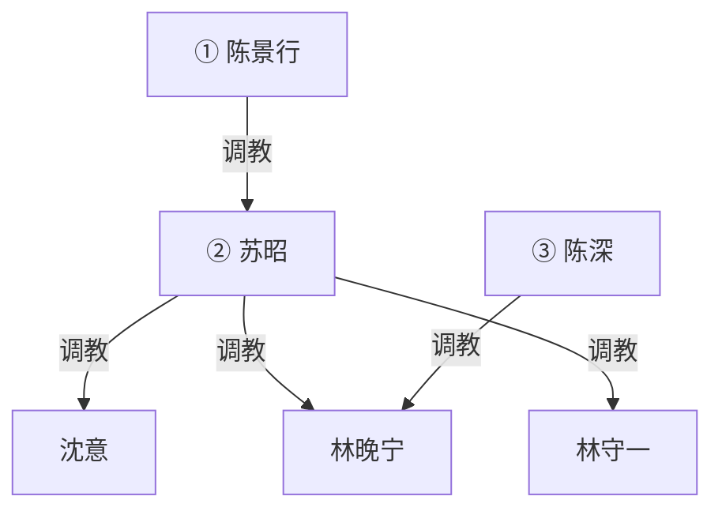

# 《霸凌者的孩子》规划

**性质**：新稿方向规划（未定稿、未排期、不上线）。
**对应文件名（若写）**：`_posts/YYYY-MM-DD-bully-victim-children-marriage.md`
**暂定标题**：`"霸凌者的孩子"`（可改 `"谈婚论嫁"`、`"同事的妈妈"`）。
**原则**：
- **上一代**：**女主女奴**（苏昭收沈意）。大学校园霸凌（全员已成年）。只写大学。
- **陈家**：**丈夫更强势**。苏昭靠校花身份嫁给有权有势的高富帅陈景行。家里他压她；她对沈意仍是女主。
- **这一代**：**男主女奴**。陈深、林晚宁约二十五岁，**工作后认识**。在一起不久就开始。二人关系**参考冯策和周晚白**（`zhou-wanbai-outline.md` / `zhou-wanbai-threads.md` 的 A 线）：虐待口吻的生活服侍 + 性奴；她提分手，被骂，道歉，被叫去陪睡。不是徐博文那种讲伦理的圈养。不把周晚白全文的派对、闺蜜收编、对冯策开战搬进来。
- **夫妻不同姓**：女方婚后不改姓。陈景行 × 苏昭；林守一 × 沈意；陈深 × 林晚宁。子女随父姓。
- 权级同向：陈家在上，林家在下。不翻案。不跟 `in-laws.md` 抢彩礼/舅舅线。

---

## 〇、一句话

大学里校花苏昭把同班沈意踩成狗，毕业靠这张脸嫁进陈家，丈夫陈景行有权有势、比她更强。二十多年后，他们的儿子陈深在公司里追求沈意的女儿林晚宁。在一起不久，他就开始欺负她，把她当婢女和性奴。二十五岁上下，要见家长谈婚。苏昭认出沈意。

---

## 一、为什么值得写（和已有稿的差）

| 已有 | 差在哪 |
|------|--------|
| `in-laws.md` | 彩礼、舅舅控场。本篇发动机是认人。钱和房子由陈景行随口定，不写成要彩礼大战。 |
| `daughters-boyfriend.md` | 爹看女儿男友。本篇是**双方母亲都有旧账**，陈深这一代自己已是男主，父亲比母亲更强。 |
| 林宇校园帝国 | 校园只在父母代大学。 |
| `mrs-zhao.md` / 女 S 当家 | 苏昭对外、对沈意是女主，**在自己家里不是最高位**。 |
| 周晚白 / 冯策 | 子女二人关系照抄这一对的相处，不抄那篇的社交帝国。本篇多两家认人。 |

不选「受害者发迹」。也不选苏昭家里再养一个窝囊丈夫——那条已经否掉。

---

## 二、人物介绍

六人。删掉旧设定里的家奴丈夫陈建平。不写第三家、舅舅、老师。

### 关系（见面之前）

- 陈景行 ↔ 苏昭：夫妻。他调教她。她是校花妻子，不是对外的女主人压过丈夫。
- 沈意 ↔ 林守一：夫妻。**林家内部没有调教权级**。她没把大学的事告诉他。两人都软，不是女主男奴，也不是他压她。
- 陈深 ↔ 林晚宁：同事，刚在一起。关系照冯策 / 周晚白：他打、用、贬、管社交，明着可以有别人；她极致服从、极致畏惧，分手失败。在一起不久就开始。
- 苏昭 与 沈意：大学旧主奴，断了二十多年。两边孩子都不知道。陈景行也不知道这段，除非苏昭当笑话提过「大学有个贱人」而不提姓名。
- 陈景行 与 陈深：父子。家规、事业、怎么对人，父亲说了算。**不画父子性奴**。
- 苏昭 与 陈深：母子。教他带人、教他养女人，不拿儿子当奴。

### 陈景行（男，四十八）——陈家最高位

有权有势的高富帅。脸、身材、家底都压过大学那一届男生。不是苏昭的同学奴，是她毕业后嫁进去的那个人。公司或家里产业说了算（具体职务后定，正文点到即可）。

家里他更强势：规矩、钱、性、苏昭的面子，都由他定。苏昭靠校花身份进门，进门后是他的人。对外他们是体面夫妻；门一关，她听他的。

见林家之前，他不一定认得沈意。认人之后他可以下场，也可以让老婆表演旧规矩给他看——他喜欢看校花妻子把别的女人按在脚下，这不降低他压她。谈婚时房子、工作、住哪，他说了算。若他当面收过沈意、林晚宁或林守一，才画他指向林家；默认先画他调教苏昭，林家仍由苏昭开第一刀。

### 苏昭（女，四十七）——上一代女主（陈家次级）

大学校花，班里带头的人。漂亮，会带人，不讲理。毕业靠校花身份嫁给陈景行，进陈家当太太，姓仍是苏。现在保养得好，对外是陈太太苏昭；在丈夫面前收着，对沈意仍是旧主。

大学时收过沈意：跑腿、罚跪、当众踩、舔鞋、口交、宿舍椅垫、当众羞辱。倒叙里帮凶是别的女生或围观，**不是现在的丈夫**。偶尔跟陈景行提大学有人跪过她，当炫耀校花岁月，没去找。

儿子第一次带林晚宁进门时，她还不认得沈意。只凭眼色看不起：家境、衣服、坐姿、说话、茶、手。百般刁难挑刺，把人当试用工和女仆：倒茶、洗碗、扫地、削水果、挨骂、重做。**做错了还打手心、打手臂**（尺子或家法板，当小孩罚）。不是客气的未来婆婆。丈夫在场时她仍收着一点，丈夫不拦她使唤、打手。认出沈意之后，旧规矩当众使，刁难升级成收奴。她不是全家最高位。林晚宁在陈家被她当女仆使唤、骂、打过手心手臂，这条边就算落地。

### 沈意（女，四十七）——上一代女奴

大学被校花苏昭按在最底下的女生。毕业后逃掉。安静、客气，邻里觉得温柔。嫁给更软的林守一，姓仍是沈。女儿林晚宁随父姓，像她。

家里她管柴米油盐，当不成主：谁一硬她就让，所以丈夫偶尔提高音量她先软，丈夫心软了她又把事情揽回来。大学那套她压着，不拿丈夫当奴，也不肯让丈夫拿她当奴——两边都像碰那块旧伤。见苏昭第一眼，身体先认。高潮场里当众做旧规矩。重新归苏昭。

### 林守一（男，四十八）

沈意的丈夫，林晚宁的爸。工薪，户主写他的名。想当好丈夫好爸爸，力气和脾气都不够。不喝酒打人，不在外面养人。护女儿是口头上的，真碰上硬的就鞠躬赔笑。

不知道妻子大学那段，也不知道女儿在陈深那儿跪。见家长前把陈深当「能干的男孩」，把高攀陈家当福气。看见妻子跪了之后崩溃，不是怒，是怕。入图从被收的那场起。默认苏昭先手。

### 林家内部（见面之前）

用来反衬陈家。陈家有主；林家和睦、没主。**图上不画林守一与沈意之间的边。**

- **钱**：普通工薪。他上班挣钱，她文员或家里为主（后定一种即可）。一套普通房，存款经不起陈景行随口一句话。见陈家会自卑，但他们把自卑说成客气。
- **谁当家**：名义他是户主，实际没人拍板。买菜、女儿衣服沈意定；换工作、买房、谈婚这种大事两个人互相看、互相推，最后拖到不能不答应。
- **吵架**：有，短，不大声。他先憋，她先软，再一起道歉。邻里觉得这家人好说话、不惹事。
- **性**：少，关灯，不命名。她偶尔会突然低头、跪到床边或把脸埋下去，他当她累了、害羞了，从没问过大学。不是女主，也不是他调教她。
- **女儿**：两人一起惯。晚宁小时候一哭就停，长大了报喜不报忧，他们把听话当成懂事。不知道她在外面跪、口、做家务奴。管教最多是「别太累」「对男朋友好一点」。
- **见陈家前的心理**：高攀。林守一预备鞠躬敬茶；沈意预备赔笑、称陈太太、把女儿往前送。没人预备自己会跪。林晚宁回家仍装刚谈恋爱、男朋友对她好，他们信。她不敢说自己已经在人家公寓里跪着擦地、口、被当性奴。

不写成：沈意在家当女 S 泄压；林守一家暴或酒后打人；林家先有一套夫妻奴。那会跟陈家撞，也分流认人那场。

### 陈深（男，二十五）——这一代男主

陈景行和苏昭的儿子。脸像爸，带人像妈。公司里岗位更靠前，有家里托底，不写职场发迹史。

工作后认识林晚宁。约会没几回就确认关系；**在一起不久就按冯策那套用她**。不是温吞处一年，也不是讲安全词的男 S。陆深评冯策的那句也适用于他：**虐待，不是调教**。

口气和手段对齐冯策：打、掐、按头；生活上让她当婢女（光脚、怕吵醒、不冲水、做饭打扫、司机或接送、跪着递东西）；性上用嘴、逼、屁眼，尿、舔蛋和屁眼；用完不哄；说玩她是荣幸，别的女人比她好看，他想要哪个要哪个。管她的微信、出门、和男同事说话。可以明着找别人，她不敢管。打完她不敢问能不能走。

真心想把人锁进陈家，要的方式是占住、打服、带去见家长。不知道妈妈大学具体做过什么。这套是自己开的，像冯策，不是学苏昭大学那套女校花。

带林晚宁回陈家见父母。妈妈刁难、打手心手臂时他不护着，让她听、让她伸手，甚至补一句刺。认出沈意之后不救林家。只直接调教林晚宁。不画他指向沈意，除非正文写他单独收岳母。

### 林晚宁（女，二十五）——这一代女奴

沈意的女儿。入职后和陈深认识。听话，不太会拒绝——他就是从这里下手的。叙述者建议用她的第一人称，口吻靠近周晚白：怕、羞、仍报恋爱。提过分手，被骂，自己道歉，然后被叫去陪睡。

对齐周晚白的日子：早上光脚、怕吵醒他、厕所不敢大声冲水；被叫立刻到；闺蜜或同事劝过她离开，她不敢答应。见家长是她单独去陈家（林守一、沈意先不在）。苏昭看不起她，百般刁难挑刺。她隐忍听话，像女仆一样在陈家干活、挨骂，做错了伸手给苏昭打手心、打手臂，不敢顶。陈深不护着。对外回家仍说「阿姨对我挺严的、我再好好表现」。不知道苏昭是她妈的旧主。认人之后更想退，退不成。看见母亲跪会羞耻，恨不成翻案。

### 二人关系（对冯策 / 周晚白）

抄关系，不抄周晚白那篇的社交帝国。

| 抄 | 不抄进本篇主线 |
|----|----------------|
| 在一起不久就上手 | 大学旧阶梯、悉尼线 |
| 生活婢女：光脚、怕吵醒、跪着服侍、当司机 | 闺蜜局被他收编成长线 |
| 性奴：口、操、尿、舔屁眼、打完不哄 | 「对冯策开战」、陆深/阮夏劝分长篇 |
| 贬她：别的女更好看，玩她是荣幸 | 把陈深写成要和徐博文拼伦理 |
| 管微信、管和男人说话；明着可以有别人，她不敢管 | 本篇发动机仍是两家认人、谈婚 |
| 分手失败：她提分 → 他骂 → 她道歉 → 他叫去陪睡 | 见家长前先写十章派对 |

**分手这场必写**，顺序不准改：

1. 她鼓起勇气提分手（被打、被贬、或刚看见他跟别人之后）。
2. 他骂：不识好歹、玩她是荣幸、她配不上、谁准她提的。可以扇、按头、不许哭出声。不讲道理，不挽留那种平等分手。
3. 她垮，道歉，收回分手，认错，求他别再生气。
4. 他消气或不消气，直接叫她留下来陪睡：当晚滚床单、口、操，用完让她跪在床边或脚边睡，或抱着当抱枕。不是和好约会，是收回去继续用。

见家长可以紧接这场之后的白天或周末。她嘴上刚道过歉，身体还酸，已经要见他父母。

屎可以进货架，开门不必第一场就上。女同事/别的女人点到即可，证明他是冯策那种人，不要写成第二部。

陆深那种「先试、讲规则、门口跪送」不是陈深。陈深不讲安全词，说停也不停。

---

## 三、时间线

1. **大学**  
   校花苏昭收沈意。只倒叙一场。丈夫陈景行还不在这段里。

2. **毕业嫁人**  
   苏昭嫁陈景行。家里他压她。沈意嫁林守一，断了联络。

3. **空白二十多年**  
   陈家有钱有势，林家普通。两边生了孩子。

4. **子女工作后、在一起不久**  
   认识、约会、确认关系。很快按冯策 / 周晚白那套。她提分手，被骂，道歉，被叫去陪睡。与两家旧账无关。

5. **林晚宁去陈家见父母**  
   沈意、林守一不在。苏昭看不起她，百般刁难挑刺。她隐忍听话，像女仆一样干活挨骂。做错了苏昭打她手心、手臂。陈深不护。陈景行压场，可以看，可以随口再刺一句。此时苏昭还不认出沈意。

6. **两家见面 / 谈婚**  
   林家被叫来。苏昭认出沈意。女仆那段已经发生过，认人是加码。

---

## 四、推荐主线

陈家在上，林家在下。陈景行压苏昭，苏昭压沈意，陈深压林晚宁。

高潮分两截：

- 先：林晚宁在陈家当女仆，苏昭挑刺、骂、使唤，做错了打手心、打手臂，她隐忍伸手。
- 后：两家见面，苏昭点破「你妈以前就是这样跪的」；林晚宁看见母亲跪，也看见自己刚挨过的那个婆婆在陈景行一句里就收声。
- 谈婚：陈景行定房子、住哪、谁管钱；苏昭定跪、称呼、林家上门服役；沈意重新归苏昭，林守一一并收。林晚宁婚前就已经在陈家干女仆的活。

### 不走的岔路

- 苏昭家里再设一个窝囊丈夫。
- 陈景行大学就在场帮苏昭霸凌（他不是同学奴）。
- 反转翻案、子女校园、中学上性、母子/父子性奴。
- 女方随夫姓（两对父母和子女这代都不改姓）。
- 林家先写成女主男奴或家暴户。林家内部无调教，认人之后才被陈家收。
- 陈深与林晚宁处一年才收。要写在一起不久就开始。
- 把陈深写成徐博文/陆深那种讲伦理的调教。他参考冯策：虐待口吻；分手是骂、道歉、叫去陪睡，不是冷静谈开。
- 分手写成他挽留、讲感情、或她甩手上门。必须是她提分、他骂、她道歉、他叫陪睡。
- 把周晚白全文的派对、闺蜜收编、开战搬进本篇当主线。本篇主线仍是认人谈婚。
- 苏昭第一次见林晚宁就客气、或当场认出沈意。要先刁难女仆、后认人。
- 林晚宁在陈家顶撞苏昭、或陈深护着她跟妈妈吵。她隐忍，他不护。

---

## 五、调教权级

陈景行与陈深无主奴边。苏昭与陈深无主奴边。林家的边只画已经当面收过的。

默认图（陈景行还没对林家下手，苏昭已收沈意；林晚宁在陈家当女仆挨骂之后苏昭→林晚宁落地；林守一要等两家见面才收）：

最高位是陈景行。苏昭是次级女主。陈深只直接调教林晚宁。若陈景行当面收沈意或林晚宁，再补他指向她们的边，不要为了好看预先连。不画跨级冗余：有 `陈景行 → 苏昭 → 沈意` 就不要再画 `陈景行 → 沈意`，除非他不经由苏昭、单独收过。

不画：大学围观、公司同事、彩礼谈判、被蒙在鼓里阶段的林守一。

---

## 六、章节节奏

1. **分手被骂、道歉、陪睡**：她提分手。他骂。她道歉。他叫她留下来陪睡。可以写到第二天早晨。
2. **去陈家见父母**：只有她和陈深。苏昭看不起，百般刁难挑刺（茶、坐、衣服、家境、手、称呼）。她隐忍听话，像女仆一样干活挨骂：倒茶、洗碗、扫地、重做。做错了苏昭打手心、打手臂，她伸手挨，不敢缩。陈深不护。陈景行在场压着苏昭，但不拦使唤、打手。
3. **可再去一次陈家**：女仆日常加码，仍不叫林家。苏昭还没认出沈意。手心、手臂可以留下痕，回家要遮。
4. **两家见面认人**：林家被叫来。苏昭叫出「沈意」。沈意身体先认。林晚宁已经在这栋房子里干过活。
5. **倒叙大学一场**：校花女主女奴。丈夫不在场。
6. **第一轮清算**：苏昭让沈意做旧规矩。陈景行看着，一句都比苏昭重。林守一崩溃。
7. **陈深站边**：不救。拿「你妈」压林晚宁。
8. **收林守一**：苏昭先手，或陈景行让他跪给陈家。
9. **谈婚改口**：景行定物质，苏昭定规矩。林晚宁继续当家里的女仆。
10. **订婚后第一周**：两代并表。苏昭在丈夫面前仍收着。

叙述者建议：**林晚宁第一人称**。

---

## 七、货架（未圈选）

- 苏昭大学女帮凶（只背景，不进现在）
- 陈景行让苏昭当着林家的面跪/口，证明校花妻子也是他的
- 陈景行收沈意（独立于苏昭才画边）
- 陈深的同事见过林晚宁跪
- 婚房钥匙、户口本、改口酒
- 苏昭把大学旧规矩写成纸，给陈深养林晚宁；陈景行改两笔

不写：未成年学生、真实学校名、报警翻案、怀孕胁迫（除非用户后加）。

---

## 八、发布口径

- 新稿写完前不发布；收束用默认完结。
- 仅改格式时不动 `last_modified_at`。
- 正文全角标点、弯引号；标题 YAML 用 ASCII 双引号。

---

## 九、待用户拍板

1. 叙述者是否林晚宁第一人称？
2. 陈景行见林家时下不下手（收沈意 / 收林晚宁 / 只压苏昭）？
3. 苏昭打手心、手臂已定。第一次见，性上到哪一步（先只骂、干活、打手，还是当场跪、口）？
4. 林晚宁去陈家几次之后才叫林家来认人？
5. 林家内部是否就按「和睦没主、无调教」写？
6. 现在停在大纲，还是开写正文？
