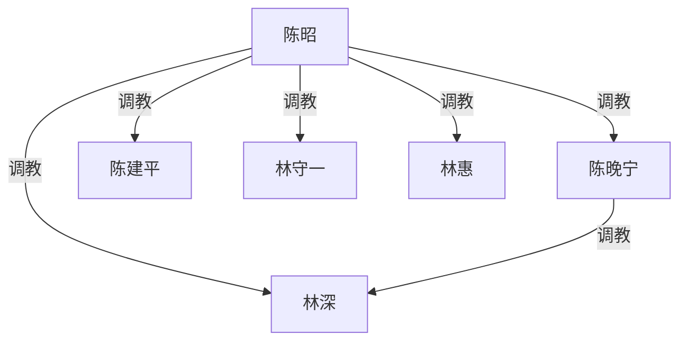

# 《霸凌者的孩子》规划

**性质**：新稿方向规划（未定稿、未排期、不上线）。
**对应文件名（若写）**：`_posts/YYYY-MM-DD-bully-victim-children-marriage.md`
**暂定标题**：`"霸凌者的孩子"`（可改成更含蓄的，如 `"同班同学的孩子"`、`"谈婚论嫁"`）。
**原则**：父母代的「校园」只写**大学**（全员已成年）。不写未成年性内容；中学若要提，只作一句背景、无性、无调教。不跟 `_posts/ideas/in-laws.md` 抢彩礼/舅舅线。

---

## 〇、一句话

二十多年前同班里，陈昭带着人把林守一踩成班里的狗；如今她女儿陈晚宁和林守一的儿子林深谈恋爱、要见家长。两家坐到一张桌上谈婚，旧账被认出来，谈婚论嫁变成两代人并表。

---

## 一、为什么值得写（和已有稿的差）

| 已有 | 差在哪 |
|------|--------|
| `in-laws.md` | 彩礼、舅舅控场、庄老师空降。本篇最高位是**当年女霸凌者本人**，发动机是认人，不是要钱。 |
| `daughters-boyfriend.md` | 爹看女儿男友 pal 猎手。本篇是**双方父母都有旧账**，不是单方入侵。 |
| `dominant-moms-house-rules.md` / 林宇线 | 校园帝国是子女代自己打的。本篇校园帝国在**父母代大学**，子女是继承或误入。 |
| `mrs-zhao.md` | 赵女士中学被霸凌后长成女 S。本篇是霸凌者并未改过、受害者并未翻身，权级**同向继承**。 |

不选「受害者发迹、霸凌者没落」的反转：那种容易写成社会清算。本站口径是调教权级延续，不是翻案剧。

---

## 二、人物（全员现在 24–48 岁）

### 父母代（大学同班，约二十四年前）

- **陈昭**：当年班里带头的女霸凌者。漂亮、会带人、不讲理。毕业后没改，家里说一不二。女儿像她。
- **陈建平**：陈昭大学时就使唤过的同学，后成丈夫。听老婆的。对林守一没有独立调教史，入图与否看正文是否写他当面收过林。默认：**不入最高位，也不另画他调教林家**——他只是陈昭的家奴丈夫，对林家是旁观/帮忙按人。
- **林守一**：当年被陈昭当众使唤、罚跪、舔鞋、口、当众羞辱的男同学。毕业后不敢联系她。娶了更软的林惠。儿子性格像他。
- **林惠**：不知道丈夫大学那段。软，会护儿子，护不住。正文里被陈昭收过之后才入图。

### 子女代（大学同学或刚工作，约 24–26 岁）

- **陈晚宁**：陈昭的女儿。不知道妈妈大学做过什么具体的事，只 inher 气场。对林深已经是女 S：规矩、罚、口交、家务奴。真心喜欢他，喜欢的方式是养着。
- **林深**：林守一的儿子。对陈晚宁自愿服从。见家长前以为最难的是「丈母娘严」，不知道丈母娘是他爸的旧主。

不写第三家、不写舅舅、不写老师空降。人少，认人场面才尖。

---

## 三、时间线（只作骨架）

1. **大学（父母代，全成年）**  
   陈昭收林守一：跑腿、罚跪、当众踩、舔鞋、口交、偶尔带到宿舍当椅垫。陈建平在场帮着按过，自己也被陈昭罚。林守一毕业后逃掉，没公开认主仪式，但事实调教已成立。

2. **空白二十多年**  
   两家不相往来。陈昭偶尔跟建平提「守一那狗不知道死哪去了」。林守一做噩梦。两边都生了孩子，没把旧事当家史讲。

3. **子女恋爱（已发生，可倒叙）**  
   晚宁和林深恋爱一年。晚宁先收的林深，不是因为知道两家关系。林深没跟父母细说被管成什么样。

4. **正文从「见家长 / 谈婚」起**  
   林家备礼上门，或两家饭店。陈昭看见林守一的脸。

---

## 四、推荐主线（同向继承，不翻案）

**权级方向与当年相同**：陈家在上，林家在下。子女恋爱不是纠正历史，是把两家重新焊在一起。

高潮不是「儿子为父亲报仇」，也不是「林守一翻身」。高潮是：

- 陈昭当众点破「你爸以前就是这样跪的」；
- 林深看见父亲跪，晚宁看见母亲收奴；
- 谈婚条件变成：婚后林家上门为奴、林深是婿奴、林守一重新归陈昭、林惠一并收。

林深可以痛、可以想退婚，退不成。晚宁可以吃惊，但不站到林家那边——她更兴奋「原来这是家传的」。

### 不走的岔路（先否掉，避免写散）

- **反转翻案**：林家发财、陈家穷、儿子压丈母娘。跟本站多数家主线拧着，也容易社会事件口吻。
- **子女平等恋爱、父母私下清算**：子女线会变旁观，浪费「谈恋爱、谈婚论嫁」这句命题。
- **中学霸凌闪回上性**：政策上不允许。中学最多一句「初中也欺负过别人」，不写身体。

---

## 五、调教权级（按 AGENTS.md：只画已落实或已写定的远期调教）

正文若按主线写完，图是这样。校园霸凌本身不入图；大学里已经发生的性支配才算。陈建平若只帮着按人、自己没收林守一，不画他指向林家。

最高位是陈昭。陈晚宁只直接调教林深；她对林守一、林惠若只是旁观母亲收奴，**不要**再画她指向公婆。陈昭对林深要单独收过一次（见面当晚或订婚后）才画跨代那条——不是只经由女儿。

陈昭调教女儿：家法、规矩、教她怎么养男人。若正文里母亲从没调过晚宁、只是气场像，则删掉 `陈昭 --> 陈晚宁`，两人横排时给陈昭加 `①`、晚宁加 `②`。

不画：大学同学围观、同事、彩礼谈判、被蒙在鼓里阶段的林惠（收她之前）。

---

## 六、章节节奏（见家长起，约 8–12 场，不写章标题进正文除非原文需要）

1. **林深视角上门前**：晚宁的规矩（手机、跪、口、家务），他紧张见丈母娘。
2. **两家见面认人**：寒暄半页，陈昭叫出「林守一」。林守一的身体先认。
3. **倒叙大学一场**（成年）：把「跪、鞋、口」写清楚，证明旧账是调教不是普通霸凌。只一场，不写成校园长篇。
4. **饭店或林家客厅的第一轮清算**：陈昭让林守一当众做一件当年的旧规矩（跪、叫主人、舔鞋）。林惠崩溃。林深想拦。
5. **晚宁站边**：确认她不救林家；开始拿「你爸」压林深。
6. **收林惠**：不是打亲情牌，是让她看见丈夫的嘴在陈昭鞋上，再让她选——跟丈夫一起跪，或当场散席、婚也不谈。她跪。
7. **陈昭单独收林深**：跨代那条线落地。晚宁在场学习。
8. **谈婚论嫁改口**：不是彩礼数字战。条件是称呼、住哪、谁管钱、林家多久上门服役、林守一是否对女儿也要跪。钱可以带一句，不要写成 `in-laws.md`。
9. **订婚后的第一周日常**（可缩）：两代人同一套规矩并表。停在一个稳定画面，不要开放式复仇。

叙述者建议：**林深第一人称**，认人时才懂父亲的抖；倒叙大学用父亲后来说、或陈昭当众讲。不要全知轮换太多。

---

## 七、货架（未圈选，写的时候再挑）

- 陈昭大学宿舍里其他女同学（只背景，不收进现在）
- 陈建平当面给林守一口，证明丈夫也在陈昭下面帮凶
- 晚宁的闺蜜见过林深跪，婚后第一次两家宴请时在场
- 林深的朋友劝他分手，被晚宁处理
- 婚房钥匙、户口本、改口酒作为规矩道具
- 陈昭把林守一的旧规矩写进「家规纸」给晚宁照着养林深

不写：未成年学生、真实学校名、报警翻案、怀孕胁迫（除非用户后加）。

---

## 八、发布口径

- `status`：新稿写完前不发布；写完且收束用默认完结，不写连载。
- 仅改格式时不要动 `last_modified_at`。
- 正文全角标点、弯引号；标题 YAML 仍用 ASCII 双引号。
- 人名/地名发布前再 Grep 一遍，避免和已上线稿撞车。

---

## 九、待用户拍板

1. 主线是否就用「同向继承、陈昭最高位」？
2. 叙述者是否林深第一人称？
3. 陈昭是否家法调教女儿（图上那条母女线）？
4. 见面场景：林家上门，还是饭店，还是陈家？
5. 现在写大纲就停，还是按第六节开写正文？
