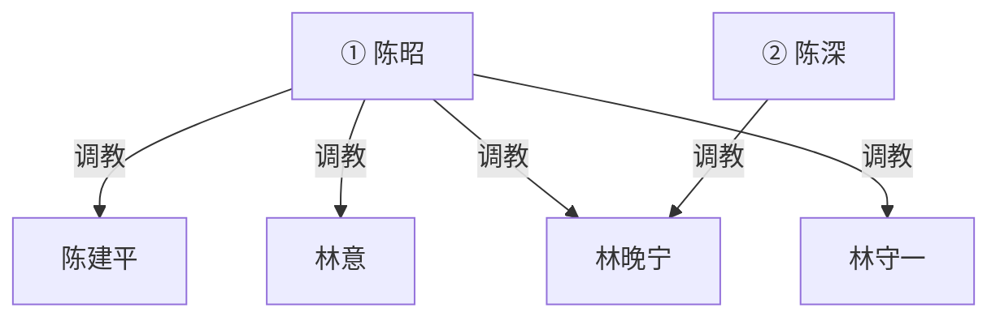

# 《霸凌者的孩子》规划

**性质**：新稿方向规划（未定稿、未排期、不上线）。
**对应文件名（若写）**：`_posts/YYYY-MM-DD-bully-victim-children-marriage.md`
**暂定标题**：`"霸凌者的孩子"`（可改 `"谈婚论嫁"`、`"同事的妈妈"`）。
**原则**：
- **上一代**：**女主女奴**。大学校园霸凌（全员已成年）。只写大学，不写中学身体、不写未成年性内容。
- **这一代**：**男主女奴**。约二十五岁，**工作后认识**，恋爱、谈婚。正文日常不写他们的校园。
- 权级同向：陈家在上，林家在下。性别换代，不翻案。
- 不跟 `_posts/ideas/in-laws.md` 抢彩礼/舅舅线。

---

## 〇、一句话

二十多年前大学里，陈昭把同班的林意踩成狗；如今陈昭的儿子陈深和林意的女儿林晚宁在公司里恋爱，二十五岁上下，男主女奴，要见家长谈婚。两家一桌，陈昭认出林意。

---

## 一、为什么值得写（和已有稿的差）

| 已有 | 差在哪 |
|------|--------|
| `in-laws.md` | 彩礼、舅舅控场。本篇最高位是**当年女霸凌者本人**，发动机是认人，不是要钱。 |
| `daughters-boyfriend.md` | 爹看女儿男友。本篇是**双方母亲都有旧账**，男友这一代自己已是男主。 |
| 林宇校园帝国 | 帝国是子女自己打的。本篇校园只在**父母代大学**，子女在公司里相遇。 |
| `mrs-zhao.md` | 被霸凌后长成女 S。本篇霸凌者没改、受害者没翻身，权级**同向继承**（女主→儿子男主；女奴→女儿女奴）。 |

不选「受害者发迹、霸凌者没落」。

---

## 二、人物介绍

六人。不写第三家、舅舅、老师。子女现在不在上学。

### 关系（见面之前）

- 陈昭 ↔ 陈建平：夫妻。她调教他。
- 林意 ↔ 林守一：夫妻。她没把大学的事告诉他。家里她也不强，丈夫更弱，还没到夫妻奴。
- 陈深 ↔ 林晚宁：同事，恋爱约一年，准备谈婚。他调教她。
- 陈昭 与 林意：大学旧主奴，断了二十多年。两边孩子都不知道。
- 陈昭 与 陈深：母子。家规严，教他怎么当主，**不拿儿子当性奴**。见面之前，陈昭不知道儿子已经在养女人。

### 陈昭（女，四十七）——上一代女主

当年大学班里带头的人。漂亮，会带人，不讲理。现在保养得好，气场更稳，是家里说一不二的女主人。正文不必展开职场帝国。

大学时收过林意：跑腿、罚跪、当众踩、舔鞋、口交、带去宿舍当椅垫、当众羞辱。丈夫陈建平是同学里先被她使唤、后娶回家的。儿子陈深像她的骨头，不像她的脸。她偶尔跟建平提「林意那贱人」，当笑话说，没去找。

见面认出林意之后，旧规矩直接当众使。最高位。林意由她自己重新收。林晚宁若她当面单独收过，才画跨代那条，不假手儿子。

### 陈建平（男，四十八）

陈昭大学同学，后成丈夫。端正、发福、说话轻。在陈昭面前是家奴丈夫。大学时帮着按过林意，自己也被罚。

不单独调教林家，不入指向林家的边。见面时认得林意，不敢先开口。林晚宁起初会把他当「好说话的未来公公」。

### 林意（女，四十七）——上一代女奴

大学被陈昭按在最底下的那个女生。毕业后逃掉。外表安静、客气，邻里觉得她温柔。嫁给更软的林守一，家里她也当不了主，更不敢把陈昭那套用在任何人身上。女儿林晚宁像她。

大学的事当成病，做噩梦，不讲。见陈昭第一眼，身体先认：抖、想跪、想逃。高潮场里会当众把旧规矩做出来。重新归陈昭。

### 林守一（男，四十八）

林意的丈夫，林晚宁的爸。弱、好说话、护女儿护不住。不知道妻子大学那段，也不知道女儿在男朋友那儿跪。见家长前把陈深当「能干的男孩」，把陈昭当「要讨好的亲家」。

看见妻子的嘴在陈昭鞋上之后崩溃。入图从被收的那场起。默认由陈昭收（全家并进），陈深若没单独调教他，不画陈深指向他。

### 陈深（男，二十五）——这一代男主

陈昭的儿子。同公司里岗位更靠前。利落、会带人，对林晚宁已经是男主：查手机、罚、口交、家务奴、出门规矩。真心喜欢她，喜欢的方式是养着。

不知道妈妈大学具体做过什么，只继承气场。见家长前紧张的是「带女朋友回家过妈妈那关」。认出之后不救林家——更兴奋这是家传的。只直接调教林晚宁。林意由妈妈收；他可以在场学习，未经手就不画他指向林意。

### 林晚宁（女，二十五）——这一代女奴

林意的女儿。入职后和陈深认识，恋爱一年。听话、脸干净、不太会拒绝。叙述者建议用她的第一人称。

对陈深自愿服从，已经习惯跪、口、家务，当两人的秘密。见家长前怕「婆婆严」「妈妈担心」。不知道婆婆是她妈的旧主。认人之后想拦、想退婚，拦不住。陈昭单独收过她一次之后，她是媳妇奴，也是陈昭的跨代奴。看见母亲跪会羞耻、会恨，恨不成翻案。

---

## 三、时间线

1. **大学（父母代，全成年）**  
   陈昭收林意：跑腿、罚跪、当众踩、舔鞋、口交、宿舍椅垫。陈建平帮着按过。林意毕业后逃掉。  
   **正文只倒叙一场**。不写成校园长篇。

2. **空白二十多年**  
   两家不相往来。陈昭偶尔提「林意那贱人」。林意做噩梦。两边都生了孩子，没当家史讲。

3. **子女工作后恋爱（已发生，可倒叙）**  
   同公司认识。恋爱约一年。陈深先收的林晚宁，与两家旧账无关。林晚宁没跟父母细说被管成什么样。

4. **正文从「见家长 / 谈婚」起**  
   林家备礼上门，或两家饭店。陈昭看见林意的脸。

---

## 四、推荐主线（同向继承，不翻案）

陈家在上，林家在下。上一代女主女奴，这一代男主女奴。子女恋爱不是纠正历史。

高潮：

- 陈昭当众点破「你妈以前就是这样跪的」；
- 林晚宁看见母亲跪，陈深看见自己母亲收女朋友的妈；
- 谈婚条件变成：婚后林家上门为奴、林晚宁是媳妇奴、林意重新归陈昭、林守一一并收。

林晚宁可以痛、可以想退婚，退不成。陈深可以吃惊，但不站到林家。

### 不走的岔路

- **反转翻案**：林家发财压陈家。
- **子女平等恋爱、父母私下清算**。
- **写子女校园**。
- **中学霸凌闪回上性**。
- **陈昭性调教儿子**：家规可以严，不画母子性奴。

---

## 五、调教权级

校园霸凌本身不入图；大学里已经发生的性支配才算。陈深与陈昭彼此无主奴，儿子不是妈的奴。横排时陈昭加 `①`、陈深加 `②`。陈昭若当面单独收过林晚宁，才画跨代那条。

最高位是陈昭。陈深只直接调教林晚宁。林守一被陈昭收之前不入图。不画陈深→林意，除非正文写他单独收过岳母。

不画：大学围观、公司同事、彩礼谈判、被蒙在鼓里阶段的林守一。

---

## 六、章节节奏（见家长起，约 8–12 场）

1. **林晚宁视角上门前**：下班后陈深的规矩（手机、跪、口、家务），她紧张见婆婆。
2. **两家见面认人**：寒暄半页，陈昭叫出「林意」。林意的身体先认。
3. **倒叙大学一场**：女主女奴。跪、鞋、口。只一场。
4. **第一轮清算**：陈昭让林意当众做一件旧规矩。林守一崩溃。林晚宁想拦。
5. **陈深站边**：不救林家；拿「你妈」压林晚宁。
6. **收林守一**：看妻子的嘴在陈昭鞋上，选跟跪或散席。他跪。
7. **陈昭单独收林晚宁**：跨代线落地。陈深在场学习。
8. **谈婚改口**：称呼、住哪、谁管钱、林家多久上门服役、林意是否对陈深也要跪。钱带一句即可。
9. **订婚后第一周**（可缩）：两代人同一套规矩。停在稳定画面。

叙述者建议：**林晚宁第一人称**。倒叙大学用母亲后来说、或陈昭当众讲。

---

## 七、货架（未圈选）

- 陈昭大学宿舍其他女同学（只背景）
- 陈建平当面使唤林意，或被陈昭按着一起用
- 陈深的同事见过林晚宁跪（下班局）
- 林晚宁的同事劝她分手，被陈深处理
- 婚房钥匙、户口本、改口酒当规矩道具
- 陈昭把大学旧规矩写成「家规纸」给陈深养林晚宁

不写：未成年学生、真实学校名、报警翻案、怀孕胁迫（除非用户后加）。

---

## 八、发布口径

- 新稿写完前不发布；收束用默认完结。
- 仅改格式时不动 `last_modified_at`。
- 正文全角标点、弯引号；标题 YAML 用 ASCII 双引号。
- 发布前 Grep 人名，避免撞车。

---

## 九、待用户拍板

1. 叙述者是否林晚宁第一人称？
2. 陈昭是否当面收林晚宁（图上跨代那条）？
3. 陈深是否单独收岳母林意？（默认不收）
4. 见面场景：林家上门，还是饭店，还是陈家？
5. 现在写大纲就停，还是按第六节开写正文？
