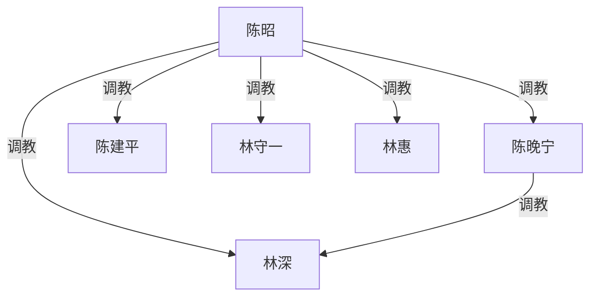

# 《霸凌者的孩子》规划

**性质**：新稿方向规划（未定稿、未排期、不上线）。
**对应文件名（若写）**：`_posts/YYYY-MM-DD-bully-victim-children-marriage.md`
**暂定标题**：`"霸凌者的孩子"`（可改 `"谈婚论嫁"`、`"同事的妈妈"`）。
**原则**：
- **上一代**：大学校园霸凌（全员已成年）。只写大学，不写中学身体、不写未成年性内容。
- **这一代**：约二十五岁，**工作后认识**，恋爱、谈婚。正文日常不写他们的校园。
- 不跟 `_posts/ideas/in-laws.md` 抢彩礼/舅舅线。

---

## 〇、一句话

二十多年前大学里，陈昭把同班的林守一踩成狗；如今她女儿陈晚宁和林守一的儿子林深在公司里恋爱，二十五岁上下，要见家长谈婚。两家一桌，旧账被认出来。

---

## 一、为什么值得写（和已有稿的差）

| 已有 | 差在哪 |
|------|--------|
| `in-laws.md` | 彩礼、舅舅控场。本篇最高位是**当年女霸凌者本人**，发动机是认人，不是要钱。 |
| `daughters-boyfriend.md` | 爹看女儿男友。本篇是**双方父母都有旧账**。 |
| 林宇校园帝国 | 帝国是子女自己打的。本篇校园只在**父母代大学**，子女在公司里相遇。 |
| `mrs-zhao.md` | 被霸凌后长成女 S。本篇霸凌者没改、受害者没翻身，权级**同向继承**。 |

不选「受害者发迹、霸凌者没落」：那是翻案剧。本站口径是调教权级延续。

---

## 二、人物

### 父母代（大学同班，约二十四年前；现在约四十七八）

- **陈昭**：当年班里带头的女霸凌者。漂亮、会带人、不讲理。家里说一不二。女儿像她。
- **陈建平**：大学时就被陈昭使唤的同学，后成丈夫。听老婆的。默认不单独调教林家，只帮着按人。
- **林守一**：当年被陈昭当众使唤、罚跪、舔鞋、口、羞辱。毕业后不敢联系。娶了更软的林惠。儿子像他。
- **林惠**：不知道丈夫大学那段。软，护儿子护不住。被陈昭收过之后才入图。

### 子女代（约二十五岁，同事）

- **陈晚宁**：陈昭的女儿。不知道妈妈大学具体做过什么，气场像。对林深已是女 S：规矩、罚、口交、家务奴。真心喜欢，喜欢的方式是养着。
- **林深**：林守一的儿子。入职后和晚宁熟的。对她自愿服从。见家长前只怕「丈母娘严」，不知道丈母娘是他爸的旧主。

不写第三家、不写舅舅、不写老师空降。人少，认人场面才尖。不写他们现在还在上学。

---

## 三、时间线

1. **大学（父母代，全成年）**  
   陈昭收林守一：跑腿、罚跪、当众踩、舔鞋、口交、带去宿舍当椅垫。陈建平在场帮着按过，自己也被罚。林守一毕业后逃掉。事实调教已成立。  
   **正文只倒叙一场**，证明是调教不是普通欺负。不写成校园长篇。

2. **空白二十多年**  
   两家不相往来。陈昭偶尔跟建平提「守一那狗」。林守一做噩梦。两边都生了孩子，没当家史讲。

3. **子女工作后恋爱（已发生，可倒叙）**  
   同公司或业务对口认识。恋爱大约一年。晚宁先收的林深，与两家旧账无关。林深没跟父母细说被管成什么样。

4. **正文从「见家长 / 谈婚」起**  
   林家备礼上门，或两家饭店。陈昭看见林守一的脸。

---

## 四、推荐主线（同向继承，不翻案）

**权级方向与大学时相同**：陈家在上，林家在下。子女恋爱不是纠正历史，是把两家重新焊在一起。

高潮不是儿子为父报仇，也不是林守一翻身。高潮是：

- 陈昭当众点破「你爸以前就是这样跪的」；
- 林深看见父亲跪，晚宁看见母亲收奴；
- 谈婚条件变成：婚后林家上门为奴、林深是婿奴、林守一重新归陈昭、林惠一并收。

林深可以痛、可以想退婚，退不成。晚宁可以吃惊，但不站到林家——她更兴奋「原来这是家传的」。

### 不走的岔路

- **反转翻案**：林家发财压陈家。
- **子女平等恋爱、父母私下清算**：浪费谈婚命题。
- **写子女校园**：已否。他们工作后认识。
- **中学霸凌闪回上性**：不允许。中学若提，一句带过、无身体。

---

## 五、调教权级

校园霸凌本身不入图；大学里已经发生的性支配才算。陈建平若只帮着按人、没收林守一，不画他指向林家。

最高位是陈昭。陈晚宁只直接调教林深；旁观母亲收公婆就不要再画她指向林守一、林惠。陈昭对林深要单独收过一次才画跨代那条。

若母亲从没调过晚宁、只是气场像，删掉 `陈昭 --> 陈晚宁`，横排时陈昭加 `①`、晚宁加 `②`。

不画：大学围观同学、公司同事、彩礼谈判、被蒙在鼓里阶段的林惠。

---

## 六、章节节奏（见家长起，约 8–12 场）

1. **林深视角上门前**：公司下班后晚宁的规矩（手机、跪、口、家务），他紧张见丈母娘。
2. **两家见面认人**：寒暄半页，陈昭叫出「林守一」。林守一的身体先认。
3. **倒叙大学一场**：跪、鞋、口。只一场。
4. **第一轮清算**：陈昭让林守一当众做一件旧规矩。林惠崩溃。林深想拦。
5. **晚宁站边**：不救林家；拿「你爸」压林深。
6. **收林惠**：看丈夫的嘴在陈昭鞋上，选跟跪或散席。她跪。
7. **陈昭单独收林深**：跨代线落地。晚宁在场学习。
8. **谈婚改口**：称呼、住哪、谁管钱、林家多久上门服役、林守一是否对女儿也要跪。钱带一句即可。
9. **订婚后第一周**（可缩）：两代人同一套规矩。停在稳定画面。

叙述者建议：**林深第一人称**。倒叙大学用父亲后来说、或陈昭当众讲。

---

## 七、货架（未圈选）

- 陈昭大学宿舍其他女同学（只背景，不进现在）
- 陈建平当面给林守一口
- 晚宁的闺蜜见过林深跪（同事或下班局，不是同学）
- 林深的同事劝他分手，被晚宁处理
- 婚房钥匙、户口本、改口酒当规矩道具
- 陈昭把大学旧规矩写成「家规纸」给晚宁养林深

不写：未成年学生、真实学校名、报警翻案、怀孕胁迫（除非用户后加）。

---

## 八、发布口径

- 新稿写完前不发布；收束用默认完结。
- 仅改格式时不动 `last_modified_at`。
- 正文全角标点、弯引号；标题 YAML 用 ASCII 双引号。
- 发布前 Grep 人名，避免撞车。

---

## 九、待用户拍板

1. 主线是否就用「同向继承、陈昭最高位」？
2. 叙述者是否林深第一人称？
3. 陈昭是否家法调教女儿（图上那条母女线）？
4. 见面场景：林家上门，还是饭店，还是陈家？
5. 现在写大纲就停，还是按第六节开写正文？
