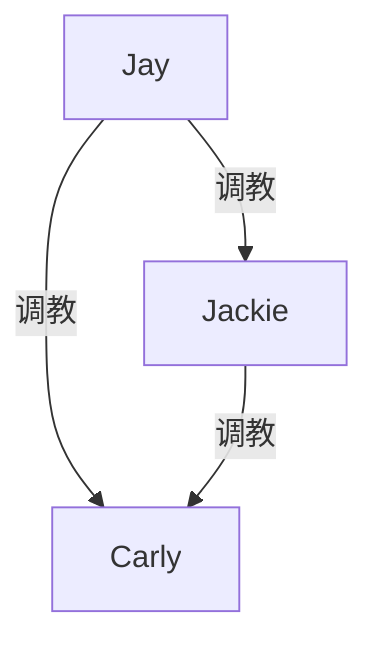

# Carly's WMAF Fantasy — Asian Ex Reunion Plan

**Status:** Story / continuation planning document (`published: false`, not for site publication).
**Source series:** *Carly's WMAF Fantasy* by Masterful_Husband (Literotica, 32 parts).
**Companion plans:** `_posts/ideas/carly-young-family-plan.md` (Young family rewrite) and `_posts/ideas/carly-jackie-backstory-plan.md` (Jackie Brown prequel, loving revenge, and post-revenge `Jackie → Carly` bedroom Dom).

---

## Core Direction

Canon never names Carly's Asian boyfriends, but the Jackie plan already established the type: earnest, high-achieving Brown men she dated to satisfy **Chen** and to hide after Jackie kept stealing her white dates. They were polite, never stood up to Jackie, and left Carly secretly contemptuous even while she knelt for Jackie behind closed doors.

This beat brings **one** of them back—**Daniel Liu**—after Carly is already Jay's First Wife, the Brown debt with Jackie has been settled, and Jackie topping Carly in bed is **consensual play under Jay's permission**. He arrives with **Yilin Wang**, the mainland FOB girlfriend he landed after striking out with white women and ABCs. He is not added to the training graph. He is a **mirror**: the man Chen would have approved of, standing next to the only kind of woman who still treats him as a catch, watching the ABC he dated kneel for a white Master.

---

## Why This Hits the Raceplay Core

- **Chen's preferred son-in-law, in the flesh.** Daniel is everything Chen wanted for Carly: Chinese-American, Brown, now a respectable Boston professional. Meeting him after the wedding pays off Chen's Pt. 15 *"lily white hands"* line without needing Chen in the room.
- **The dating market as hierarchy.** After Carly, Daniel tried to date **white women** and **ABCs** and failed at both. White girls never chose him; ABCs wanted the same dominance Carly was already kneeling for. The only woman who still sees a Brown PE VP as a prize is **FOB**—someone whose status map was formed in China, not at Brown.
- **Two Chinese women, two endings.** Carly (ABC, First Wife, diamond *"Jay's Slut"* choker) versus Yilin (mainland, traditional, proud to be on Daniel's arm). Same ethnicity on paper; the room can see who sits where.
- **Proof Carly was never "saved."** Daniel still believes Jackie was a college bully Carly escaped. Watching married First Wife Carly drop her Ivy poise for Jay—and still take orders from Jackie—kills that story, and kills his cope that *he* ended up with the more "appropriate" Chinese girlfriend.
- **Jackie as living continuity.** A Brown reunion naturally puts Jackie in the same room. She will clock Yilin in one glance and say the quiet part out loud.
- **No new harem girl, no new submissive man to train.** Yilin is Daniel's girlfriend, not Jay's project. The scene stays inside `Jay → Jackie → Carly`. Daniel and Yilin only witness.

---

## Character Dossier — Daniel Liu

- **Identity:** Chinese-American, Carly's year at **Brown**, econ/CS. Now a VP at a Boston PE firm. Dresses well, still a little stiff, still the "good son."
- **College relationship:** Dated Carly junior year for about four months—the longest of her Asian boyfriends. Met Chen once over winter break; Chen liked him immediately. Carly was polite, sexually withheld, and already kneeling for Jackie in the dorm. Daniel thought the distance was shyness plus family pressure.
- **How he failed in front of Jackie:** Jackie called him Carly's *"safe little study buddy"* at a house party, sent Carly to fetch her coat mid-date, and later texted Carly to come home while they were at a restaurant. Daniel apologized to Jackie to avoid a scene and walked Carly back. He never asked Carly what was actually happening in that suite.
- **After Carly — failed with white women:** A few Brown/Boston first dates that never became second dates; one white coworker who let him pay for dinners and used him as a sounding board, then got engaged to a white guy in her office. He told himself it was numbers, not desire.
- **After Carly — failed with ABCs:** Two serious attempts. One ABC (also finance, also immigrant-parent polish) liked him on paper and went cold in bed; she later dated a white consultant. Another told him, kindly, that he felt like a *"nice Chinese boyfriend"* and she did not want to be her mother. He heard Carly in that sentence and did not know why.
- **What he believes now:** He did not fail. He "got serious" and found someone with values. Carly went through a rough roommate situation, then married a successful white guy. He is ready to be gracious about it, and quietly proud of Yilin as proof he still won. He is not ready for the choker, *Master*, Jackie, or Carly reading Yilin in one look.
- **What he is not:** Not a secret Dom, not a cuckold-in-waiting, not a rival Jay needs to break. His power is **decency plus cope**. Using him as another Hideo/Chen clone would waste the contrast.

---

## Character Dossier — Yilin Wang

- **Identity:** Mainland Chinese (Shanghai / Hangzhou), mid-20s, in Boston on a master's. Met Daniel through a family introduction / WeChat circle of "successful ABC men." English is fluent enough for a reception and still clearly not native. Pretty, well-dressed, slightly overdressed for Brown casual-alumni—she dressed for *his* status.
- **How she sees Daniel:** He is the catch. Brown, PE, American passport, Chinese enough to bring home. She defers in the traditional way Carly refused to: lets him order, translates social cues off his face, is proud to be introduced as his girlfriend.
- **How she sees Carly:** At first, an impressive ABC alumna with a handsome white husband—exactly the American picture she half-wants and half-resents. Then the choker, the *Master*, Jackie snapping her fingers. Yilin does not have the kink vocabulary. She looks at Daniel to explain, which makes him smaller.
- **What she is not:** Not a secret submissive waiting for Jay. Not a girl Jackie gets to keep. Stealing her would turn this into another harem beat and flatten Daniel's consolation prize. She leaves the weekend still his girlfriend, shaken, and newly unsure why an ABC like Carly would kneel to a white man *and* a white woman.

---

## Placement in the Timeline

After:
1. The Pt. 26 wedding / stay-behind outing.
2. Jay's **loving revenge night** on Jackie (Brown debt paid; Carly's bitterness gone).
3. The **post-revenge equilibrium** in which Jackie is allowed to dominate Carly in the bedroom because it arouses Jay, Carly, and Jackie.

Before or beside, not instead of, the Young-family post-wedding beats. This is an external Brown/Boston mirror, not a Young-household scene.

---

## Setting — Brown Alumni Weekend, Providence

A Saturday evening reception on campus (Sayles / a rented hall on Thayer). Public enough that Carly starts in First Wife polish; private corners (coat check, hotel suite, a quiet stair) for the real sting. Jay attends as her husband. Jackie comes because she never misses a chance to be seen, and because Jay told Carly it would be more fun if her old roommate was there. Daniel brings **Yilin** to show her the campus he talks about, and to show his class he did fine.

---

## Beat Sheet

### Beat 1 — Polite Reunion, Plus the Girlfriend
Daniel spots Carly, lights up, and comes over with Yilin a half-step behind him. Genuine warmth: Carly looks extraordinary, he heard she got married, congratulations. He introduces Yilin with a little too much pride—*master's in Boston, just got here last year*—the way a man introduces proof. Yilin smiles, calls Carly *jie*, compliments the choker as beautiful jewelry. She does not clock *"Jay's Slut."*

Daniel shakes Jay's hand like a peer. Carly is gracious and a little tight. In the same glance she ranks Yilin: pretty, trying, FOB polish, the girl she would have been if she had stayed Chen's daughter. Jay is warm, not performatively cruel. He lets Carly have the first five minutes as the Brown valedictory version of herself.

### Beat 2 — Jackie Walks In
Jackie appears in a dress that still makes the room tilt. Daniel's body remembers before his brain does: shoulders in, smile too careful. Yilin brightens at a glamorous white alumna; she does not know she is looking at the woman who used to send Carly home mid-date.

Jackie looks Daniel up and down, then Yilin, and uses the old line without raising her voice—*"Carly's study buddy. You did go and make something of yourself."* A beat, eyes on Yilin: *"And you found a girl who still thinks that's impressive. Cute."*

Then, lightly, as if they were still in the suite: she tells Carly to get her a drink. Carly glances at Jay. Jay nods once. Carly goes.

That nod is the scene. Daniel realizes the hierarchy did not end at graduation; it just got a husband at the top. Yilin watches Carly obey a white woman and looks to Daniel; he has no translation that does not make him smaller.

### Beat 3 — The Rescue Attempt
Daniel gets Carly alone for thirty seconds (hallway, coat check, terrace). Yilin is left with Jay and Jackie for those seconds—which is its own discomfort, not a seduction.

He does the decent thing, now with extra edge: *Is he making you do this? Is Jackie still in your life? You don't have to smile through it. I can walk you out.* Underneath: *I have a real Chinese girlfriend. You don't have to live like this.*

Carly does not take it.

With Jay's prior blessing, she tells him the truth in a calm, married voice:
- Jackie did own her at Brown. He saw it and apologized to Jackie instead of asking Carly.
- White girls and ABCs did not reject him because he lacked a job. They rejected him because he is the man who says sorry to Jackie.
- Yilin is sweet. She is also the first woman since college who still lets him be the man in the room. Carly will not pretend that is the same as keeping her.
- She did not marry Jay to escape Jackie. She married the man who could hold Jackie *and* her, and who loves her as First Wife.
- The choker is not a metaphor. She belongs to Jay. Jackie is still allowed to play with her because **Jay says so**, and because Carly wants it.
- She was never going to be the wife Chen pictured with Daniel. Yilin can be. Carly is not sorry.

### Beat 4 — One Public Drop
Jay does not humiliate Daniel for sport, and he does not hit on Yilin. He also does not hide his wife.

Back in the reception, with Daniel and Yilin close enough to hear, Jay says a single quiet *slut* or *kneel* (or simply holds Carly's hair and has her fetch for Jackie again). Carly's Ivy League poise drops on a dime—eyes down, *Yes, Master*—then she is smiling on his arm again as if nothing happened. Daniel finally reads the diamond choker. Yilin goes still.

Jackie, delighted, adds one needle only Jay permits, aimed at both of them: *"She couldn't keep a white boy in college. She kept the only one who could keep her. You couldn't keep her *or* a white girl, so you imported one. Fair trade, I guess."*

Yilin does not catch every word. She catches enough. Daniel has to smile for her.

### Beat 5 — Hotel Coda (No Invitation)
Jay, Carly, and Jackie go back to the hotel. Daniel and Yilin are **not** invited, not made to watch, not turned into a cuckold couple. The cruelty is that the night continues without them.

In the room, Jackie is allowed to take Carly the old Brown way—hair, kneeling, cleaning Jay out of Jackie—while Jay fucks Jackie rough, exactly as in the post-revenge equilibrium. Carly is wet from having been seen by the man who was supposed to be her respectable ending, and from seeing who he had to date to feel like a man again. Jay's aftercare is for Carly: she told the truth in front of the old life, and he is proud of her for not lying and for not being cruel to Yilin beyond what the truth already was.

Daniel takes Yilin back to their hotel. She asks, in Chinese, what *Master* meant, and why Carly fetched drinks for that woman. He does not have an answer that keeps him the catch.

---

## What This Does for Each Person

- **Carly:** Closes the last Brown loop that was not Jackie. She is no longer the girl who dated Asian men as cover. She said it out loud to the cover, and she saw the FOB ending that cover led to.
- **Jay:** Gets to be the loving husband *and* the Master in the same evening without turning Daniel or Yilin into a project. Protects Carly from a rescue that would have shamed her.
- **Jackie:** Gets the purest possible audience for her old rush—an Asian ex who still flinches, now standing next to the only Chinese girl who still looks up to him.
- **Daniel:** Stays a decent man who lost, and whose cope (Yilin) is visible in the same frame. Breaking him like Chen or Hideo would flatten the contrast.
- **Yilin:** Leaves still his girlfriend, not Jay's. She is the innocent witness who makes the hierarchy legible: she still thinks Daniel is the prize; the room just showed her he is not.

---

## Power Structure Note

No new training edge. Daniel and Yilin never enter the graph.

Same post-revenge triangle as `_posts/ideas/carly-jackie-backstory-plan.md`. Daniel and Yilin watch from outside it.
