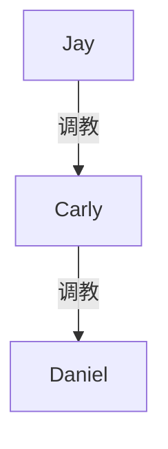

# Carly's WMAF Fantasy — Asian Ex Reunion Plan

**Status:** Story / continuation planning document (`published: false`, not for site publication).
**Source series:** *Carly's WMAF Fantasy* by Masterful_Husband (Literotica, 32 parts).
**Companion plans:** `_posts/ideas/carly-young-family-plan.md` (Young family rewrite) and `_posts/ideas/carly-jackie-backstory-plan.md` (Jackie Brown prequel, loving revenge, and post-revenge `Jackie → Carly` bedroom Dom).

---

## Core Direction

Canon never names Carly's Asian boyfriends, but the Jackie plan already established the type: earnest, high-achieving Brown men she dated to satisfy **Chen** and to hide after Jackie kept stealing her white dates. They were polite, never stood up to Jackie, and left Carly secretly contemptuous even while she knelt for Jackie behind closed doors.

This beat brings **one** of them back—**Daniel Liu**—after Carly is already Jay's First Wife. **Jay is not at the reunion.** Carly runs into Daniel and his girlfriend **Yilin Wang**, a mainland overseas student who outranks both of them on paper, wants a **green card**, and will not date FOBs.

Daniel and Yilin hold the **same private ranking: Whites > ABCs > FOBs.** He does **not** think he dated up. Yilin is the FOB he could actually hold after striking out with white women and ABCs; she is dating him because he is a citizen. The moment he sees Carly—an ABC who married white—he starts **ignoring Yilin**. Yilin does not challenge it. The ranking says not to.

Carly goes home and tells Jay. Jay, loving and ruthless in the same breath, **orders her to go back and dominantly seduce Daniel**—not as a lifestyle Domme, as First Wife acting on Master's instruction. Daniel is the one man from Brown who was supposed to be her respectable ending. Jay wants him folded under Carly.

---

## Why This Hits the Raceplay Core

- **Shared map, different rungs.** Daniel and Yilin already agree on Whites > ABCs > FOBs. He ignores her for Carly because Carly sits higher on *his* map (ABC, white husband). She lets him because Carly sits higher on *hers* too. Nobody has to invent the hierarchy; they perform it in a campus reception.
- **Jay is absent, then present as will.** The reunion is Carly's alone, so the later seduction is clearly **his order**, not a jealous husband crashing an alumni mixer. She comes home, reports, and is sent back armed.
- **Carly tops from below.** She does not become Jackie. She dominates Daniel *because she belongs to Jay*. The choker is the rank. Daniel finally gets the ABC girl he still ranks above his FOB girlfriend—and she will not let him have her as a man. She uses him.
- **Chen's preferred son-in-law, used.** Daniel is everything Chen wanted. Jay never has to meet him to put him under Carly.
- **Yilin is not a stereotype and not a fighter.** Overachiever, GC motive, same ranking. She watches herself get dropped in real time and stays consistent.

---

## Character Dossier — Daniel Liu

- **Identity:** Chinese-American, Carly's year at **Brown**, econ/CS. Now a VP at a Boston PE firm. Dresses well, still a little stiff, still the "good son."
- **Internal ranking (same as Yilin):** **Whites > ABCs > FOBs.** He does not think Yilin is an upgrade on Carly. He thinks he **dated down** after failing to hold a white woman or an ABC. Yilin is what he could get. He is not cruel to her in speeches. He is cruel in attention.
- **College relationship:** Dated Carly junior year for about four months—the longest of her Asian boyfriends. Met Chen once over winter break; Chen liked him immediately. Carly was polite, sexually withheld, and already kneeling for Jackie in the dorm. Daniel thought the distance was shyness plus family pressure. He also ranked her as the ABC he was lucky to have, and never recovered from losing her.
- **How he failed in front of Jackie:** Jackie called him Carly's *"safe little study buddy"* at a house party, sent Carly to fetch her coat mid-date, and later texted Carly to come home while they were at a restaurant. Daniel apologized to Jackie to avoid a scene and walked Carly back. He never asked Carly what was actually happening in that suite.
- **After Carly — failed with white women:** A few Brown/Boston first dates that never became second dates; one white coworker who let him pay for dinners and used him as a sounding board, then got engaged to a white guy in her office. That failure sits at the top of his ranking and still stings.
- **After Carly — failed with ABCs:** Two serious attempts. One went cold and dated a white consultant. Another told him he felt like a *"nice Chinese boyfriend."* He heard Carly in that sentence.
- **What he believes when he sees Carly:** She married white, which on his map is marrying **up**. He is pulled to her immediately—old want, plus proximity to the rung he could not reach. Yilin, standing next to him, becomes background. He does not decide to insult her. He just stops looking at her.
- **What he is not:** Not a secret Dom, not proud of "dating up," not a rival Jay needs to meet. His power is **the ranking plus leftover want.** Breaking him like Chen in a living-room demo would waste him. Carly taking him apart on Jay's order is the point.

---

## Character Dossier — Yilin Wang

- **Identity:** Mainland Chinese overseas student. Mid-20s, Boston on an F-1, almost certainly **MIT / Harvard** (or equivalent)—harder program than Brown, olympiad / publication / internship credentials Daniel and Carly do not have. Fluent English, slight accent she does not hide, dressed like she belongs at a faculty mixer.
- **Overachiever, above both of them:** She knows it. She is polite about it. She does not need to say it.
- **Private ranking: Whites > ABCs > FOBs.** Same map as Daniel. White partner = top of the local market; ABC = passport, still Chinese enough to take home; FOB = same boat, no immigration value. She does not date FOBs. That is a rule.
- **Why Daniel:** He is an **ABC and a citizen**. Marriage is a green-card path. He is successful enough that her parents will accept the story. He is not white. She knows the difference.
- **Why she does not challenge the snub:** Carly is ABC and married to a white man. On Yilin's map that is **above** her. Fighting Carly for Daniel's attention would be fighting up the ladder. She holds the ranking, so she stands there, still, and lets herself be ignored. It humiliates her. It also makes sense to her. She will not make a scene to defend a position she does not believe she holds.
- **What she is not:** Not a wide-eyed traditional girlfriend. Not a girl who thinks Daniel is the catch of her life. Not Jay's next project unless a later beat says so. Not someone who asks what *Master* means; she is not at the seduction unless Carly or Jay puts her there.

---

## Placement in the Timeline

After:
1. The Pt. 26 wedding / stay-behind outing.
2. Jay's **loving revenge night** on Jackie (Brown debt paid; Carly's bitterness gone).
3. The **post-revenge equilibrium** in which Jackie is allowed to dominate Carly in the bedroom because it arouses Jay, Carly, and Jackie.

Jackie is **not required** at this reunion. This is Carly, Daniel, and Yilin, then Jay at home. Before or beside, not instead of, the Young-family post-wedding beats.

---

## Setting — Brown Alumni Weekend, Providence (Jay not present)

A Saturday evening reception on campus (Sayles / a rented hall on Thayer). Carly attends as an alumna / First Wife without Jay—he stays in Boston/NYC, or she is up for the weekend on her own. Daniel brings Yilin to show the campus. No public *Master* drop, no Jackie drink-fetch. The heat is social: who he looks at.

---

## Beat Sheet

### Beat 1 — Reunion: He Stops Seeing Yilin
Daniel spots Carly and lights up too fast. Introductions happen because they have to: this is Yilin, MIT, the lab; this is Carly, married. He says *congratulations* and does not ask the husband's name for a few seconds too long.

Then he is only talking to Carly. Old nicknames, old professors, *you look incredible*, standing in her sightline. Yilin answers one question when Carly includes her, then is not included. Daniel's body has already ranked the room: white-married ABC in front of him, FOB girlfriend beside him. He does not think he dated up. He thinks the upgrade just walked in, and she is not his.

Carly is gracious, a little tight, and she clocks it immediately—the way he used to look at her at Brown, plus the way he is not looking at Yilin. She is not cruel here. She also does not rescue Yilin. She files it.

### Beat 2 — Yilin Holds the Ranking
Yilin does not take his arm, does not needle him, does not compete. She stands with a drink and lets the conversation happen over her. Internally she agrees: Carly married white. That is above an ABC-FOB couple. Making him attend to her would be asking him to rank down in public.

Carly sees that too—the other woman is not meek, she is **consistent**. That is what Carly later names for Jay.

Daniel asks if Carly is in town tomorrow, if they could get coffee, catch up without the noise. He does not look at Yilin when he asks. Yilin looks at Carly, not at him, and does not object.

Carly says maybe. She goes back to her hotel. She does not kiss him. She does not correct him. She takes the whole thing home.

### Beat 3 — Carly Reports to Jay
Jay gets the aftercare version first: she is his, she is home, she is a little shaken and a little wet. Then the report, precise because he likes her precise.

- Daniel still wants her. He ranked her above the woman he arrived with in under a minute.
- He does not think Yilin is an upgrade. Same map as Yilin: whites, then ABCs, then FOBs. He dated down and could not hide it once an ABC who married white was in the room.
- Yilin is the real overachiever, she is here for a green card, and she **let herself be ignored** because she holds that ranking too.
- Daniel asked for coffee. Carly did not say yes.

Jay is not jealous of Daniel. He is interested. The boy Chen would have picked is still orbiting his wife, and he did it in front of a woman who agrees she sits lower.

### Beat 4 — Jay's Order
Jay does not go to Providence. He sends **Carly**.

The instruction is specific enough that she cannot turn it into a soft reunion:
- Go back. Take the coffee. **Dominantly seduce him.**
- She is not asking Daniel if he missed her. She is taking him.
- He does not get her holes—those are Jay's (Pt. 25: no other flesh-and-blood cock). She uses his mouth, his pride, his ranking.
- She does it as *his* wife. The choker stays on. If Daniel wants the ABC who married white, he can have the terms that come with her.
- She reports everything. If she wants to be cruel, she has permission. If she starts feeling like she is cheating, she is to remember she is working.

This is Jay being loving in his language: he heard that her old cover still thinks he has a claim, and he is giving her the kill shot instead of going himself.

### Beat 5 — Carly Tops Daniel
Coffee becomes a walk becomes her hotel room, or his, if Yilin is elsewhere. Carly does not flirt from below. She talks down the map he already believes:

- He ignored a woman smarter than both of them because Carly is ABC and married white. She names it.
- He never stood up to Jackie. He never kept a white girl. He never kept her. He is not going to keep her now.
- She belongs to Jay. Daniel can kneel for a piece of that, or he can go back to the girlfriend he does not look at.

He folds the way he folded at Brown—polite, hungry, ashamed, still ranking her above Yilin while she ranks him under her shoe. She has him on his knees, mouth on her, her hand in his hair the way Jackie used to hold hers. She does not come for *him*; she comes because Jay told her to take this. She does not let Daniel inside her. She might make him thank her, make him admit the ranking out loud, make him admit he was already cheating in his head the second he saw her.

She texts Jay from the bathroom. Jay tells her whether to send Daniel home to Yilin still ignored, or to make Daniel say something to Yilin. Default: send him back. Let him sit next to the woman he ranked below Carly with Carly's taste still in his mouth.

### Beat 6 — After
Carly comes home to Jay and drops back into First Wife / slut with no leftover Domme in her posture. The dominance was an errand. He takes her properly, the way Daniel was not allowed to, and praises her for doing it well.

Daniel is not added as a household slave unless a later beat wants that. The immediate result is enough: Chen's preferred boy, used by the daughter Chen lost, on the white husband's order, while the FOB girlfriend who shares his ranking does not even get to contest it.

Yilin, if she notices the shift when he comes back, still does not challenge. She may decide the GC is still worth it. She may start looking past him harder. She does not pick a fight with Carly.

---

## What This Does for Each Person

- **Carly:** Closes the Brown cover by topping it. She is not the girl who dated Daniel to hide. She is the wife Jay sent to take him. Then she goes home and is his again.
- **Jay:** Never needed to enter the room. Loving because he believed her and armed her; Master because the seduction is an order, not a hall pass.
- **Daniel:** Gets the ABC he still ranks above Yilin, and only as someone he is not allowed to fuck. His map is used against him.
- **Yilin:** Stays consistent and unpaid for it. She let the snub happen because the ranking said so. She is still not a training node unless a later beat makes her one.

---

## Power Structure

Jay remains the only top. Carly's edge to Daniel is **directed**, not a new identity: she trains/uses him because Jay told her to. Yilin stays off the graph.

Jackie is unchanged in `_posts/ideas/carly-jackie-backstory-plan.md` and is simply not in this scene. Do not draw `Jay -->|调教| Daniel` unless Jay later handles him in person. Do not draw Yilin at all unless she is actually trained.
