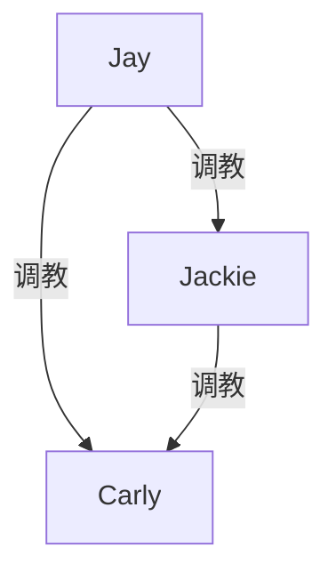

# Carly's WMAF Fantasy — Asian Ex Reunion Plan

**Status:** Story / continuation planning document (`published: false`, not for site publication).
**Source series:** *Carly's WMAF Fantasy* by Masterful_Husband (Literotica, 32 parts).
**Companion plans:** `_posts/ideas/carly-young-family-plan.md` (Young family rewrite) and `_posts/ideas/carly-jackie-backstory-plan.md` (Jackie Brown prequel, loving revenge, and post-revenge `Jackie → Carly` bedroom Dom).

---

## Core Direction

Canon never names Carly's Asian boyfriends, but the Jackie plan already established the type: earnest, high-achieving Brown men she dated to satisfy **Chen** and to hide after Jackie kept stealing her white dates. They were polite, never stood up to Jackie, and left Carly secretly contemptuous even while she knelt for Jackie behind closed doors.

This beat brings **one** of them back—**Daniel Liu**—after Carly is already Jay's First Wife, the Brown debt with Jackie has been settled, and Jackie topping Carly in bed is **consensual play under Jay's permission**. He arrives with **Yilin Wang**, a mainland **overseas student** who is the better overachiever in the room, privately ranks **Whites > ABCs > FOBs**, and is dating Daniel because he is a U.S. citizen—**a green-card path**, not a love match with a man she looks up to.

He is not added to the training graph. He is a **mirror**: the man Chen would have approved of, standing next to a woman who outranks him and is using him as the ABC step below white, watching the ABC he dated kneel for a white Master.

---

## Why This Hits the Raceplay Core

- **Chen's preferred son-in-law, in the flesh.** Daniel is everything Chen wanted for Carly: Chinese-American, Brown, now a respectable Boston professional. Meeting him after the wedding pays off Chen's Pt. 15 *"lily white hands"* line without needing Chen in the room.
- **The dating market as hierarchy, visible in one couple.** Daniel struck out with **white women** and **ABCs**. Yilin will not date **FOBs**—same visa class, no green card, bottom of her own ranking. She dates Daniel because he is an **ABC with a passport**. She would rank **Jay higher than Daniel** on sight, before anyone says *Master*.
- **Two Chinese women, two uses of ABC men.** Carly used Daniel as cover while kneeling for Jackie. Yilin is using him for a GC while ranking whites first. Neither was ever going to make him the man in the room.
- **Yilin is not the naive FOB plus-one.** She is sharper than Daniel and Carly on paper. She reads the choker, the nod, and Jackie faster than he does. The sting is that her private ranking is **confirmed**, not that she needs someone to explain America to her.
- **Jackie as living continuity.** A Brown reunion naturally puts Jackie in the same room. She will clock Yilin as a girl who wanted white, settled for ABC, and is too smart to pretend otherwise.
- **No new training edge by default.** Yilin is Daniel's girlfriend and a witness, not Jay's next project. She looking at Jay too long is the hook; stealing her would be a different beat.

---

## Character Dossier — Daniel Liu

- **Identity:** Chinese-American, Carly's year at **Brown**, econ/CS. Now a VP at a Boston PE firm. Dresses well, still a little stiff, still the "good son."
- **College relationship:** Dated Carly junior year for about four months—the longest of her Asian boyfriends. Met Chen once over winter break; Chen liked him immediately. Carly was polite, sexually withheld, and already kneeling for Jackie in the dorm. Daniel thought the distance was shyness plus family pressure.
- **How he failed in front of Jackie:** Jackie called him Carly's *"safe little study buddy"* at a house party, sent Carly to fetch her coat mid-date, and later texted Carly to come home while they were at a restaurant. Daniel apologized to Jackie to avoid a scene and walked Carly back. He never asked Carly what was actually happening in that suite.
- **After Carly — failed with white women:** A few Brown/Boston first dates that never became second dates; one white coworker who let him pay for dinners and used him as a sounding board, then got engaged to a white guy in her office. He told himself it was numbers, not desire.
- **After Carly — failed with ABCs:** Two serious attempts. One ABC (also finance, also immigrant-parent polish) liked him on paper and went cold in bed; she later dated a white consultant. Another told him, kindly, that he felt like a *"nice Chinese boyfriend"* and she did not want to be her mother. He heard Carly in that sentence and did not know why.
- **What he believes now:** He did not fail. He "dated up"—Yilin is more impressive than Carly on paper (better school, harder field, actual prizes). He is ready to be gracious about Carly's white husband, and quietly sure that bringing Yilin proves he won the long game. He has not admitted, even to himself, that she is with him for a **green card**, or that she ranks his race below white.
- **What he is not:** Not a secret Dom, not a cuckold-in-waiting, not a rival Jay needs to break. His power is **decency plus cope**. Using him as another Hideo/Chen clone would waste the contrast.

---

## Character Dossier — Yilin Wang

- **Identity:** Mainland Chinese overseas student. Not a wide-eyed traditional girlfriend and not "imported" as a status prop. Mid-20s, in Boston on an F-1, almost certainly **MIT / Harvard** (or equivalent)—a harder program than Brown, with olympiad / publication / internship credentials Daniel and Carly do not have. Fluent English, slight accent she does not hide, dressed like someone who belongs at a faculty mixer, not like someone dressing for *his* PE title.
- **Overachiever, above both of them:** Carly was #2/#3 in a high-school class and a Brown star. Daniel is a Brown PE VP. Yilin is the person in the circle who actually won the global exam tournament. She knows it. She is polite about it. She does not need to say it.
- **Private ranking: Whites > ABCs > FOBs.** Not cartoon worship and not self-hate as a personality. It is how she reads the U.S. status market: white partner = top of the local hierarchy; ABC = American-born, passport, still Chinese enough to take home; FOB = same boat as her, no immigration value, no status bump. She does not date FOBs. That is a rule, not a preference she is shy about.
- **Why Daniel:** He is an **ABC and a citizen**. Marriage is a green-card path. He is successful enough that her parents will accept the story. He is not white. She knows the difference and is not confused about which one she would pick if both were on offer.
- **How she sees Carly, before the drop:** Another ABC alumna with a white husband—the combination Yilin ranks highest. Slight professional appraisal, not *jie*-flattery. She notices the diamond choker earlier than Daniel and files it as either expensive taste or a signal she does not yet have enough context for.
- **How she sees the room after the drop:** Her ranking, confirmed in public. White man at the top; white woman (Jackie) still able to order the ABC wife; the ABC wife kneeling; the ABC boyfriend she is using for a GC standing there with nothing to say. She does not ask Daniel what *Master* means. She already has a working theory.
- **What she is not:** Not a secret submissive waiting to be trained. Not a girl Jackie gets to keep. Not a prop who exists to look up at Daniel. She leaves the weekend still his girlfriend unless a later beat decides otherwise. The live wire is that **Jay sits at the top of a ranking she already had**, and she is too smart to pretend she did not notice.

---

## Placement in the Timeline

After:
1. The Pt. 26 wedding / stay-behind outing.
2. Jay's **loving revenge night** on Jackie (Brown debt paid; Carly's bitterness gone).
3. The **post-revenge equilibrium** in which Jackie is allowed to dominate Carly in the bedroom because it arouses Jay, Carly, and Jackie.

Before or beside, not instead of, the Young-family post-wedding beats. This is an external Brown/Boston mirror, not a Young-household scene.

---

## Setting — Brown Alumni Weekend, Providence

A Saturday evening reception on campus (Sayles / a rented hall on Thayer). Public enough that Carly starts in First Wife polish; private corners (coat check, hotel suite, a quiet stair) for the real sting. Jay attends as her husband. Jackie comes because she never misses a chance to be seen, and because Jay told Carly it would be more fun if her old roommate was there. Daniel brings **Yilin** because he wants his class to see who he is with now. Yilin comes because alumni weekends are useful American networking, and because being seen on an ABC citizen's arm is part of the GC story.

---

## Beat Sheet

### Beat 1 — Polite Reunion, Two Overachievers
Daniel spots Carly, lights up, and comes over with Yilin beside him—not a half-step behind. Genuine warmth: Carly looks extraordinary, he heard she got married, congratulations. He introduces Yilin by her credentials first, a little too pleased—*MIT, the lab, the offer*—as if the CV is the point. Yilin shakes hands like a peer, compliments nothing she does not mean, and glances once at the choker without asking.

Daniel shakes Jay's hand like a peer. Carly is gracious and a little tight: Yilin is the student she would have had to compete with if they had been in the same year, and she is on Daniel's arm anyway. Jay is warm, not performatively cruel. He lets Carly have the first five minutes as the Brown valedictory version of herself. Yilin is already ranking Jay above Daniel. She does not show it yet.

### Beat 2 — Jackie Walks In
Jackie appears in a dress that still makes the room tilt. Daniel's body remembers before his brain does: shoulders in, smile too careful. Yilin does not brighten like a tourist. She reads Jackie the way she reads a room: white, expensive, used to being obeyed.

Jackie looks Daniel up and down, then Yilin, and uses the old line without raising her voice—*"Carly's study buddy. You did go and make something of yourself."* A beat, on Yilin: she does not make the "imported a girl who still thinks that's impressive" joke. She makes the accurate one. *"Oh. She's the smart one. And she's not here for you."*

Then, lightly, as if they were still in the suite: she tells Carly to get her a drink. Carly glances at Jay. Jay nods once. Carly goes.

That nod is the scene. Daniel realizes the hierarchy did not end at graduation. Yilin does not look at Daniel for a translation. She looks at Jay, then at the choker, and files it: ABC wife, white husband, white woman still above the wife. Her map just got a legend.

### Beat 3 — The Rescue Attempt
Daniel gets Carly alone for thirty seconds (hallway, coat check, terrace). Yilin is left with Jay and Jackie for those seconds—not a seduction, a stress test. Jackie talks past Daniel's absence. Yilin answers in clean English and does not flinch. Jay stays courteous. Yilin still ranks him first.

Daniel does the decent thing, now with extra cope: *Is he making you do this? Is Jackie still in your life? You don't have to smile through it. I can walk you out.* Underneath: *I have Yilin. She is more than you. I did fine.*

Carly does not take it.

With Jay's prior blessing, she tells him the truth in a calm, married voice:
- Jackie did own her at Brown. He saw it and apologized to Jackie instead of asking Carly.
- White girls and ABCs did not reject him because he lacked a job. They rejected him because he is the man who says sorry to Jackie.
- Yilin is not proof he won. She is an overseas student who will not date a FOB because she wants a **green card**, and an ABC citizen is the step she can actually hold. If a white man with Jay's ease had asked her first, Daniel would not be in this room with her.
- Carly used him as cover. Yilin is using him as immigration. The common term is him.
- She did not marry Jay to escape Jackie. She married the man who could hold Jackie *and* her, and who loves her as First Wife.
- The choker is not a metaphor. She belongs to Jay. Jackie is still allowed to play with her because **Jay says so**, and because Carly wants it.

### Beat 4 — One Public Drop
Jay does not humiliate Daniel for sport, and he does not hit on Yilin. He also does not hide his wife.

Back in the reception, with Daniel and Yilin close enough to hear, Jay says a single quiet *slut* or *kneel* (or simply holds Carly's hair and has her fetch for Jackie again). Carly's Ivy League poise drops on a dime—eyes down, *Yes, Master*—then she is smiling on his arm again as if nothing happened. Daniel finally reads the diamond choker.

Yilin does not go wide-eyed. She goes still, then thoughtful. The ranking held. The ABC she is dating cannot do this. The white man can.

Jackie, delighted, adds one needle only Jay permits, aimed at both of them: *"She couldn't keep a white boy in college. She kept the only one who could keep her. You couldn't keep her or a white girl—so you brought a girl who wants a passport. She's already looking at him, Dan. Don't pretend you can't see it."*

Daniel has to smile. Yilin does not bother denying the look. She also does not leave his arm. The GC is still the GC.

### Beat 5 — Hotel Coda (No Invitation)
Jay, Carly, and Jackie go back to the hotel. Daniel and Yilin are **not** invited, not made to watch, not turned into a cuckold couple. The cruelty is that the night continues without them, and that Yilin now has a data point at the top of her ranking.

In the room, Jackie is allowed to take Carly the old Brown way—hair, kneeling, cleaning Jay out of Jackie—while Jay fucks Jackie rough, exactly as in the post-revenge equilibrium. Carly is wet from having been seen by the man who was supposed to be her respectable ending, and from meeting the woman who is using him more coldly than Carly ever did. Jay's aftercare is for Carly: she told the truth, she did not recruit Yilin, and she did not need to be the smartest woman in the room to be his wife.

Daniel takes Yilin back to their hotel. She does not ask what *Master* meant. She says, evenly, that Carly married well by Yilin's standards, and that Daniel should not have tried to rescue her. If she is still thinking about Jay, she does not give Daniel the satisfaction of a fight. The green card is still on the table. The ranking is not.

---

## What This Does for Each Person

- **Carly:** Closes the last Brown loop that was not Jackie. She is no longer the girl who dated Asian men as cover. She said it out loud to the cover, and she met the overseas student who is using him for a passport while ranking whites first.
- **Jay:** Gets to be the loving husband *and* the Master in the same evening without turning Daniel or Yilin into a project. He is, inconveniently, the top of a ranking Yilin already had.
- **Jackie:** Gets an audience who can actually read the room—an Asian ex who still flinches, and a FOB overachiever who is not impressed by him.
- **Daniel:** Stays a decent man who lost. His cope (Yilin as the upgrade) is visible in the same frame as her real motives. Breaking him like Chen or Hideo would flatten the contrast.
- **Yilin:** Leaves still his girlfriend, not Jay's. She is the witness who makes the hierarchy legible without being a stereotype: she already ranked whites first, she is using an ABC for a GC, and the reunion showed her an ABC wife who locked the thing Yilin actually wants.

---

## Power Structure Note

No new training edge. Daniel and Yilin never enter the graph.

Same post-revenge triangle as `_posts/ideas/carly-jackie-backstory-plan.md`. Daniel and Yilin watch from outside it. Yilin looking at Jay is appetite and ranking, not a `Jay -->|调教| Yilin` line unless a later beat makes it one.
