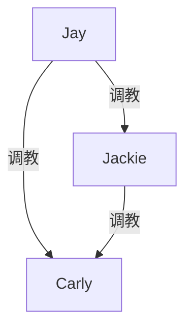

# Carly's WMAF Fantasy — Asian Ex Reunion Plan

**Status:** Story / continuation planning document (`published: false`, not for site publication).
**Source series:** *Carly's WMAF Fantasy* by Masterful_Husband (Literotica, 32 parts).
**Companion plans:** `_posts/ideas/carly-young-family-plan.md` (Young family rewrite) and `_posts/ideas/carly-jackie-backstory-plan.md` (Jackie Brown prequel, loving revenge, and post-revenge `Jackie → Carly` bedroom Dom).

---

## Core Direction

Canon never names Carly's Asian boyfriends, but the Jackie plan already established the type: earnest, high-achieving Brown men she dated to satisfy **Chen** and to hide after Jackie kept stealing her white dates. They were polite, never stood up to Jackie, and left Carly secretly contemptuous even while she knelt for Jackie behind closed doors.

This beat brings **one** of them back—**Daniel Liu**—after Carly is already Jay's First Wife, the Brown debt with Jackie has been settled, and Jackie topping Carly in bed is **consensual play under Jay's permission**. He is not added to the training graph. He is a **mirror**: the man Chen would have approved of, seeing with his own eyes that Carly did not "outgrow" Jackie or choose a normal interracial marriage. She married the white Master who finished what Brown started.

---

## Why This Hits the Raceplay Core

- **Chen's preferred son-in-law, in the flesh.** Daniel is everything Chen wanted for Carly: Chinese-American, Brown, now a respectable Boston professional. Meeting him after the wedding pays off Chen's Pt. 15 *"lily white hands"* line without needing Chen in the room.
- **Proof Carly was never "saved."** Daniel still believes Jackie was a college bully Carly escaped. Watching married First Wife Carly drop her Ivy poise for Jay—and still take orders from Jackie—kills that story.
- **Jackie as living continuity.** A Brown reunion naturally puts Jackie in the same room. For Daniel, Jackie is the ghost who used to talk over him at dinner. For Carly, Jackie is now a permitted bedroom Dom, which is hotter *because* Daniel is watching the old hierarchy and cannot interrupt it.
- **No new harem girl, no new submissive man to train.** The scene stays inside the existing `Jay → Jackie → Carly` triangle. Daniel only witnesses.

---

## Character Dossier — Daniel Liu

- **Identity:** Chinese-American, Carly's year at **Brown**, econ/CS. Now a VP at a Boston PE firm. Dresses well, still a little stiff, still the "good son."
- **College relationship:** Dated Carly junior year for about four months—the longest of her Asian boyfriends. Met Chen once over winter break; Chen liked him immediately. Carly was polite, sexually withheld, and already kneeling for Jackie in the dorm. Daniel thought the distance was shyness plus family pressure.
- **How he failed in front of Jackie:** Jackie called him Carly's *"safe little study buddy"* at a house party, sent Carly to fetch her coat mid-date, and later texted Carly to come home while they were at a restaurant. Daniel apologized to Jackie to avoid a scene and walked Carly back. He never asked Carly what was actually happening in that suite.
- **What he believes now:** Carly went through a rough roommate situation, moved to Boston, then married a successful white guy. He is ready to be gracious about it. He is not ready for the choker, *Master*, or Jackie still being in the picture.
- **What he is not:** Not a secret Dom, not a cuckold-in-waiting, not a rival Jay needs to break. His power is **decency**. Using him as another Hideo/Chen clone would waste the contrast.

---

## Placement in the Timeline

After:
1. The Pt. 26 wedding / stay-behind outing.
2. Jay's **loving revenge night** on Jackie (Brown debt paid; Carly's bitterness gone).
3. The **post-revenge equilibrium** in which Jackie is allowed to dominate Carly in the bedroom because it arouses Jay, Carly, and Jackie.

Before or beside, not instead of, the Young-family post-wedding beats. This is an external Brown/Boston mirror, not a Young-household scene.

---

## Setting — Brown Alumni Weekend, Providence

A Saturday evening reception on campus (Sayles / a rented hall on Thayer). Public enough that Carly starts in First Wife polish; private corners (coat check, hotel suite, a quiet stair) for the real sting. Jay attends as her husband. Jackie comes because she never misses a chance to be seen, and because Jay told Carly it would be more fun if her old roommate was there.

---

## Beat Sheet

### Beat 1 — Polite Reunion
Daniel spots Carly across the room, lights up, and comes over. Genuine warmth: she looks extraordinary, he heard she got married, congratulations. He shakes Jay's hand like a peer—successful men meeting at an alumni mixer. He notices the diamond choker, reads it as expensive jewelry, and does not clock *"Jay's Slut"* until later.

Carly is gracious and a little tight. Jay is warm, not performatively cruel. He lets Carly have the first five minutes as the Brown valedictory version of herself.

### Beat 2 — Jackie Walks In
Jackie appears in a dress that still makes the room tilt. Daniel's body remembers before his brain does: shoulders in, smile too careful. Jackie looks him up and down and uses the old line without raising her voice—*"Carly's study buddy. You did go and make something of yourself."*

Then, lightly, as if they were still in the suite: she tells Carly to get her a drink. Carly glances at Jay. Jay nods once. Carly goes.

That nod is the scene. Daniel realizes the hierarchy did not end at graduation; it just got a husband at the top.

### Beat 3 — The Rescue Attempt
Daniel gets Carly alone for thirty seconds (hallway, coat check, terrace). He does the decent thing: *Is he making you do this? Is Jackie still in your life? You don't have to smile through it. I can walk you out.*

This is the most dangerous moment for vanilla sympathy. Carly does not take it.

With Jay's prior blessing, she tells Daniel the truth in a calm, married voice:
- Jackie did own her at Brown. He saw it and apologized to Jackie instead of asking Carly.
- She did not marry Jay to escape that. She married the man who could hold Jackie *and* her, and who loves her as First Wife.
- The choker is not a metaphor. She belongs to Jay. Jackie is still allowed to play with her because **Jay says so**, and because Carly wants it.
- She was never going to be the wife Chen pictured with Daniel. She is sorry if that hurts. She is not sorry about the life.

### Beat 4 — One Public Drop
Jay does not humiliate Daniel for sport. He also does not hide his wife.

Back in the reception, with Daniel close enough to hear, Jay says a single quiet *slut* or *kneel* (or simply holds Carly's hair and has her fetch for Jackie again). Carly's Ivy League poise drops on a dime—eyes down, *Yes, Master*—then she is smiling on his arm again as if nothing happened. Daniel finally reads the diamond choker.

Jackie, delighted, adds one needle only Jay permits: *"She couldn't keep a white boy in college. She kept the only one who could keep her."*

### Beat 5 — Hotel Coda (No Invitation)
Jay, Carly, and Jackie go back to the hotel. Daniel is **not** invited, not made to watch, not turned into a cuckold. The cruelty is that the night continues without him.

In the room, Jackie is allowed to take Carly the old Brown way—hair, kneeling, cleaning Jay out of Jackie—while Jay fucks Jackie rough, exactly as in the post-revenge equilibrium. Carly is wet from having been seen by the man who was supposed to be her respectable ending. Jay's aftercare is for Carly: she chose this in front of someone from the old life, and he is proud of her for not lying to him or to Daniel.

Daniel leaves Providence knowing three things: Jackie still sits above Carly in bed, Jay sits above both, and the girl he dated at Brown was already gone the first time he backed down at that house party.

---

## What This Does for Each Person

- **Carly:** Closes the last Brown loop that was not Jackie. She is no longer the girl who dated Asian men as cover. She said it out loud to the cover.
- **Jay:** Gets to be the loving husband *and* the Master in the same evening without turning Daniel into a project. Protects Carly from a rescue that would have shamed her.
- **Jackie:** Gets the purest possible audience for her old rush—an Asian ex who still flinches—without being allowed to hijack Carly's marriage.
- **Daniel:** Stays a decent man who lost. That is the point. Breaking him like Chen or Hideo would flatten the contrast.

---

## Power Structure Note

No new training edge. Daniel never enters the graph.

Same post-revenge triangle as `_posts/ideas/carly-jackie-backstory-plan.md`. Daniel watches from outside it.
