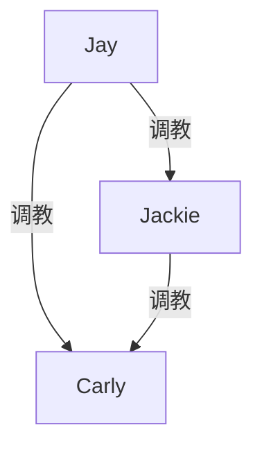

# Carly's WMAF Fantasy — Jackie Backstory & Post-Wedding Return Plan

**Status:** Story / backstory planning document (`published: false`, not for site publication).
**Source series:** *Carly's WMAF Fantasy* by Masterful_Husband (Literotica, 32 parts — Jackie appears in Pt. 17, 18, 25, and 26).
**Companion plan:** `_posts/ideas/carly-young-family-plan.md` (Young family rewrite & post-wedding 4-tier hierarchy).

---

## Core Direction

**Jackie** is the original catalyst for the entire WMAF / racial-submission premise of the series: she is the white Brown University roommate who broke Carly first, stole her boyfriends, forced Carly to kneel and clean white cum out of her pussy, and wired racialized submission into Carly's sexuality years before Jay ever entered the picture.

In canon, Jackie only appears for a quick ambush/reversal arc in Orlando (Pt. 17–18) and brief cameos at the bachelor party (Pt. 25) and wedding (Pt. 26). This plan expands:
1. **Jackie's full character dossier & hidden submissive psychology** (orientation, dating life outside boyfriend-stealing, and what "asshole alphas" made her do in bed).
2. **The Brown University prequel arc** (how Jackie controlled Carly beyond boyfriend-stealing, how Carly's Asian boyfriends fit into the hierarchy, and how Jackie's own off-campus humiliations fed her cruelty toward Carly).
3. **The Orlando pivot (Pt. 17–18)** (when Jay learned the full history and Carly's lingering resentment, and how he broke Jackie's armor).
4. **A two-phase post-wedding arc**: first **Jay's deliberate, loving revenge night** to settle the Brown University debt and heal Carly's lingering bitterness, followed by the **post-revenge equilibrium** where **Jackie stays on as Carly's consensual bedroom Dom** under Jay's roof because the dynamic arouses all three of them.

---

## Power Structure (Jackie in the Raceplay Core)

**Jay** is the sole top-level Master; he directly dominates both **Jackie** (as a rough, non-domestic brat-submissive plaything) and **Carly** (his deeply loved First Wife and #2 over the Young family). **Jackie**'s arrow to **Carly** evolves across two stages: it starts as toxic **Brown University** conditioning, gets **settled once** via Jay's loving one-night revenge reversal (`Carly` over `Jackie` under Jay's hand to clear Carly's resentment), and then **resumes consensually in the bedroom** on Jay's permission because it turns all three of them on. Outside sex—and over the Young family—Carly remains Jay's undisputed First Wife and #2.

---

## Character Dossier — Jackie

### Canon Anchors (Pt. 17, 18, 25, 26)
- **Identity & Role:** Carly's former white roommate at **Brown University**; sharp-tongued, vain, predatory, and obsessed with keeping Carly beneath her.
- **College conditioning:** Repeatedly seduced and stole Carly's boyfriends at Brown, mocked her Asian heritage, and made Carly kneel between her legs to eat her pussy—including cleaning white men's cum out of her.
- **Orlando ambush (Pt. 17–18):** Years after graduation, Jackie called Carly's old Boston roommates, tracked Carly down to Orlando, and showed up unannounced expecting to steal Jay just like Carly's college boyfriends.
- **Jay's reversal (Pt. 17):** In front of Carly and Kyrsten, Jay read Jackie's act immediately—pinning her wrists above her head, yanking her hair back, calling her a whore, smacking her ass when she protested, and forcing her to beg (*"wherever you want… fuck me"*).
- **Orientation & hidden kinks (Pt. 17):** When Jay mentioned his girlfriends watching, Jackie said: *"I'm not really into girls… Well… not since college."* When Jay asked about her kinks, she challenged him—*"You'll have to fuck it out of me"*—and after 4.5 hours alone with her, Jay staggered out exhausted admitting *"It turns out Jackie had quite a few kinks she wanted to explore."*
- **Status after Orlando (Pt. 18, 25, 26):** Unlike Carly, Jackie never becomes a devoted collar slave or calls Jay *"Master"*—she stays sharp-tongued, calls him *"stud,"* wears a **yellow collar** (open/casual play) at the Pt. 25 bachelor party (fooling around on the couch with Roland, Herman, and the other girls), and attends the Pt. 26 wedding, staying behind during Louise's outing of all the women Jay had slept with.

### Orientation & Why Carly Was a One-of-a-Kind Exception
- **Did Jackie date other girls besides Carly?** **No.** Her Pt. 17 line (*"I'm not really into girls… Well… not since college"*) confirms Carly was an anomaly, not a sign Jackie is bisexual or dates women.
- At Brown, Jackie did not "date" Carly romantically—she **kept** her. What hooked Jackie was the **power high** of breaking a rich, brilliant, proud Asian overachiever who secretly hated her and still knelt between her legs.
- Before Brown and after graduation, Jackie strictly pursues **white men**. She never found another woman who gave her that exact rush, which is why years later she still went out of her way to hunt Carly down through Boston roommates just to prove she could still take Carly's white man.

### Dating Life Outside Boyfriend-Stealing
- **Two completely different pools of men:**
  1. **Stolen boyfriends (trophies, not partners):** The white guys she poached from Carly were usually decent, flattered college boys who folded easily. Jackie had zero real respect for them; the moment Carly broke and cleaned her up, Jackie lost interest and dumped them.
  2. **The men she actually chased ("asshole alphas"):** Outside of tormenting Carly, Jackie is drawn to cocky, arrogant, physically dominant white men—frat presidents, rich finance/law jerks, players who ignore her status games, talk down to her, and refuse to simp. She is chronically allergic to nice guys and treats dating like a high-ego power struggle.
- **Why she stayed single / cynical:** The asshole alphas never committed to her—they used her hard for a few weeks or months, pushed her around in bed, and tossed her aside once they got bored. Every time one of them humiliated her, Jackie walked out with her chin up and immediately looked for someone lower on the ladder (Carly) to crush so she could feel superior again.

### Hidden Submissive Side: What the Asshole Alphas Made Her Do
To stay true to Jackie's canon characterization (sharp-tongued, calls Jay *"stud,"* never says *"Master"*), her deepest submission is **rough, ego-stripping physical domination in bed**—never domestic servitude, emotional devotion, or collared obedience:
- **What she *never* gave them:** Calling a man *Master*, wearing a permanent collar, cooking/cleaning, or acting like a devoted girlfriend. She would walk out before being anyone's meek housewife.
- **The extreme end of her private kinks:**
  1. **Rough, breathless throat-fucking & gagging:** An arrogant alpha grabbing both handfuls of her dark hair, dragging her head off the edge of the bed or pinning her against a wall, and using her throat until mascara runs down her cheeks and she cannot talk back—literally silencing her sharp mouth.
  2. **Face-slapping, spitting, and rough hair-pulling during hard sex / anal:** Being flipped over, pinned flat by the back of her neck, slapped across the face or ass whenever she snaps back, spit on or in her mouth, and taken roughly in the ass while being called a *cheap whore* or *prissy cunt* until the queen bee is reduced to incoherent begging (foreshadowed publicly by her Pt. 17 *"wherever you want… fuck me"*).
  3. **Being treated as purely disposable / shown off without asking:** Used purely as a fucktoy for a night, dismissed afterward with cum dried on her face or hair, or fucked roughly in front of an audience (previewed by her thrill at being taken in front of Carly and Kyrsten in Pt. 17 and her Pt. 25 couch play).
- **The core psychological irony:** **Everything Jackie inflicted on Carly** (hair-pulling, face-slapping, spitting, verbal degradation) is the exact physical roughness Jackie secretly craved from an asshole alpha male. The only difference is that **Jackie takes it strictly as rough physical combat in bed and puts her armor back on afterward**, whereas she forced Carly to carry that submission into everyday life and racial identity.

---

## Brown University Prequel Arc (Backstory Expansion)

### 1. How Jackie Controlled Carly Beyond Boyfriend-Stealing & Pussy-Eating
Jackie's grip on Carly at Brown was not just occasional bedroom cruelty—it was **24/7 dorm-room hierarchy**:
- **Social & status policing:** Jackie decided who Carly sat with, which parties Carly was allowed to attend, and whether Carly was introduced as a friend or an awkward hanger-on.
- **Appearance & wardrobe control:** Mocking Carly's "good Asian daughter" clothes, forcing Carly to dress down (or provocatively on command) so Carly never outshone her in public, while reminding her that white girls set the standard on campus.
- **Everyday dorm servitude & financial leverage:** Making wealthy, perfectionist Carly do her laundry, fetch coffee/food, type up or polish papers, pay for ubers/drinks, and clear out of their dorm room on ten minutes' notice whenever Jackie brought a guy back.
- **Private humiliation rituals:** Whenever Carly pushed back—or simply looked too proud after acing an exam—Jackie snapped her back down with hair-pulling, casual slaps, spitting, and making Carly kneel on the dorm carpet until she apologized and kissed Jackie's shoes or thighs.

### 2. Carly's Asian Boyfriends & How They Behaved Around Jackie
- **Why Carly dated Asian guys at Brown:** Partly to satisfy her traditional father (**Chen**) and partly as a safe refuge after Jackie kept poaching her white dates.
- **How Carly treated them:** Polite on the surface, but increasingly restless, detached, and quietly contemptuous—comparing their timid, deferential behavior to the rough dominance Jackie was conditioning her to crave. She withheld real passion from them, treated them like cover/companions rather than men who owned her, and let herself feel secretly superior to them even while kneeling to Jackie behind closed doors.
- **How they behaved in front of Jackie:** Immediately intimidated. Jackie talked over them, made cutting remarks about Asian guys being "cute study buddies" or "safe little backups," and casually ordered Carly around right in front of them—fetching Jackie's coat, leaving mid-date because Jackie texted, or canceling plans. Because they never stood up to Jackie (and actually apologized or backed down to avoid a scene), every encounter reinforced Jackie's racial hierarchy in Carly's head and made Carly resent Asian men even more.

### 3. The Stolen White Boyfriends & The Cycle of Resentment
- Whenever Carly finally worked up the nerve to date a white guy she genuinely liked, Jackie treated it as an insult to the natural order—flirting openly in front of Carly, cornering the guy at parties, and bringing him straight back to their shared suite.
- The humiliation always had three steps: **stealing him**, **making sure Carly knew/heard or watched**, and **forcing Carly to kneel and clean the white guy's cum out of Jackie's pussy** while Jackie smirked about how Carly could never keep a white man on her own.
- Once Carly broke, Jackie dumped the guy within days—proving it was never about him, only about keeping Carly broken.

### 4. Jackie's Secret Double Life Off-Campus
- Intercut with her dominance in the dorm, prequel scenes show Jackie's hidden cycle with the **asshole alphas** she actually wanted—sneaking back to the dorm late with bruised wrists, smeared mascara, and a red handprint on her cheek after being rough-handled and tossed out of a frat house or apartment.
- Rather than humbling her, coming home bruised made Jackie **meaner**: she immediately woke Carly up, shoved Carly's face between her legs, and took back the exact dominance that some arrogant guy had just stripped out of her an hour earlier.

---

## Canon Pivot — Orlando Reversal & Carly's Resentment (Pt. 17–18)

### When Jay Learned Their History & Carly's Ongoing Resentment
- **Before Jackie walked in:** Jay already knew pieces of Carly's Brown University history (how her WMAF submission started with a cruel white college roommate), or pieced together the full depth of it the moment Carly froze and paled when Jackie showed up in Orlando.
- **What Jay spotted immediately:** Beneath Carly's genuine sexual conditioning, Carly still carried **deep, unresolved resentment and humiliation** toward Jackie—not because Carly stopped loving submission to white men, but because Jackie had mocked her as someone who could *never* truly keep a high-status white man of her own.
- **How Jay reacted:**
  1. **Zero pity, total control:** Jay didn't coddle Carly or ban Jackie from the house; he saw an opportunity to **permanently claim the ghost of Carly's past** and prove he was far beyond the college boys Jackie used to poach.
  2. **Instant read on Jackie:** Within minutes of Jackie trying her old flirt-and-steal routine, Jay recognized her exact type—an arrogant brat who secretly craved getting manhandled by an unapologetic alpha.
  3. **Public breaking in front of Carly:** Pinning Jackie's wrists, yanking her hair, calling her a whore, smacking her ass, and fucking her roughly right in front of Carly and Kyrsten shattered Jackie's "untouchable queen bee" myth on the spot.
  4. **The 4.5-hour marathon:** Staying behind to *"fuck her kinks out of her"* locked Jackie into Jay's orbit on *his* terms—giving her the hardest asshole-alpha treatment she'd ever had while keeping her strictly a casual plaything (*"stud,"* yellow collar) who never threatened Carly's place as Jay's #1.
  5. **Effect on Carly:** Watching Jay reduce her lifelong tormentor to a gasping, bruised fucktoy—and then still come back to Carly as his primary woman—converted Carly's lingering resentment into deeper worship of Jay.

---

## Post-Wedding Extension Arc — Loving Revenge & Consensual Return to `Jackie → Carly`

Connects directly to `_posts/ideas/carly-young-family-plan.md`, where newly married **Carly** holds formal **2nd-in-command / First Wife** status under Jay, and balances Jay's colder treatment of Chen by spotlighting his **deeply loving, protective devotion to Carly** (*Masterful_Husband* core).

### Why Pt. 17 Alone Was Not Real Vengeance
In Orlando (Pt. 17), pinning Jackie's wrists, slapping her ass, calling her a whore, and fucking her for 4.5 hours *looked* like punishment—but because rough alpha dominance is Jackie's actual kink, **Jackie got off on it**. She walked away satisfied, still calling Jay *"stud,"* and never truly paid for four years of humiliating Carly at Brown. Beneath Carly's devotion, Jay recognizes that a real scar and bitterness still linger.

### Phase 1 — Jay's Loving Revenge Night (Settling the Brown Debt)
To genuinely avenge Carly—without turning Jackie's punishment into a kink she enjoys—Jay targets the exact four things Jackie **hates and cannot sexualize**: *submitting to Carly, mundane servitude, exposing her insecurity, and orgasm/cock denial.*

1. **The Leverage (Bargain Trap):** After Pt. 17's marathon, Jay is the best alpha lay Jackie has ever had; she comes back hungry for another night. Before laying a finger on her, Jay sets a cold, non-negotiable condition: ***"You want me to fuck you again? You owe my wife first. One full night doing whatever Carly says—and if you walk out that door, I never touch you again."*** Jackie's craving and pride lock her in.
2. **Exposing the "Queen Bee" Myth in Front of Carly:** Drawing on what he learned during Pt. 17's 4.5-hour session, Jay strips away Jackie's untouchable white-goddess aura while Jackie kneels at Carly's feet—forcing Jackie to admit out loud that the whole time she played royalty in their Brown dorm, off-campus asshole alphas were throat-fucking her, slapping her around, and tossing her out, and Carly was simply the one person Jackie could punch down on to feel big again.
3. **Unsexy Domestic Servitude:** Mirroring Brown University dorm servitude, Jackie is denied anything sexy or playful for the first half of the evening—fetching Carly's drink, kneeling to remove Carly's heels, carrying Carly's robe, and sitting silently on the floor at Carly's feet while Jay and Carly dine and talk warmly. Whenever Jackie rolls her eyes or snaps *"stud—,"* Jay shuts her down coldly with zero rough banter.
4. **The Reversed Brown Ritual (Under Jay's Backing):** Jay makes love to and claims **Carly** openly and possessively in front of Jackie while Jackie kneels beside the bed forbidden to touch herself. After Jay finishes inside his wife, he pulls Carly's legs open and **orders Jackie between Carly's thighs to eat his cum out of Carly's pussy**—a 1-to-1 flip of Brown University—with **Carly holding Jackie's dark hair** and Jay standing directly behind Jackie so she cannot pull away. Because Jackie is *"not really into girls"* and only liked the power high of topping Carly, being on the bottom gives her zero erotic thrill—pure ego defeat.
5. **The Final Sting — Denying Jackie the Reward:** Once Jackie finishes cleaning Carly up—flushed, humbled, expecting Jay to finally pin her down and fuck her rough as her payoff—**Jay refuses to touch her** (*"You paid your debt to my wife. Get dressed."*). Denying her rough alpha sex prevents her from rewriting the evening as a hot threesome; she leaves aching, defeated, and knowing Carly beat her cleanly.
6. **Loving Aftercare (The Emotional Core):** The moment the door shuts, Jay drops the cold Dom mask, pulls Carly into his arms, and gives her deep, tender aftercare—telling her plainly that he saw how much Brown still hurt her, that Pt. 17 was too fun for Jackie, and that **nobody—not her father, not her college bully—ever gets to own a piece of his wife without his blessing.**

### Phase 2 — The Post-Revenge Equilibrium: Jackie Stays as Carly's Bedroom Dom
Once the **real emotional debt is paid** and the bitterness is gone from Carly's heart, the dynamic settles into a **far hotter permanent equilibrium** on Jackie's subsequent visits:

- **Why Jackie resumes topping Carly (with Jay's explicit permission):** Now that Carly has beaten Jackie once, seen behind Jackie's insecure mask, and felt the rock-solid security of Jay's love as First Wife, **submitting to Jackie stops being trauma and becomes pure, consensual erotic play**. Topping Jackie gave Carly *closure*, not her primary sexual turn-on; Carly's deepest wiring is still kneeling to a sharp-tongued white woman while belonging to a dominant white Master.
- **How the threesomes work going forward:** On Jackie's next visit, Jay tells her *"You paid my wife back. Now—on my permission—you can play with her the old way while I fuck you."* The three-way ladder locks cleanly into place:
  - **Jay → Jackie:** Jay finally gives Jackie the rough, breathless, asshole-alpha manhandling she craves.
  - **Jackie → Carly (Bedroom / Play-Only Dom):** Back in her natural element, Jackie gets to pull Carly's hair, mock her, and make Carly kneel and clean Jay's cum out of Jackie's pussy—**strictly inside the bedroom under Jay's permission**.
  - **Jay → Carly:** Jay remains Carly's loving Master and husband; outside the bedroom (and across the Young family), Carly's First Wife / #2 rank is untouchable, and both women know Jay can flip Jackie back onto her knees for Carly anytime he chooses.
- **Why it arouses all three:**
  - **For Jay:** Peak WMAF hierarchy heat—watching his untamed white fucktoy dominate his devoted Asian wife strictly at his pleasure while he physically owns them both.
  - **For Carly:** Resentment-free indulgence of her most potent Brown-wired kink, wrapped in total emotional safety as Jay's cherished wife.
  - **For Jackie:** Both of her real cravings in the same room—getting roughly broken by the one alpha stud who matches her while getting her Brown University dominance rush over Carly back.
