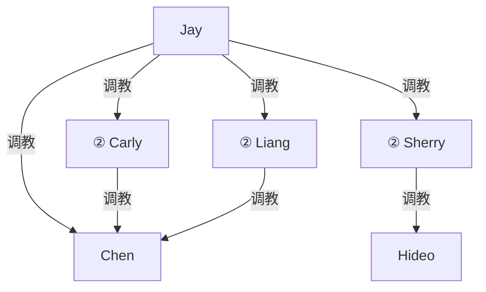

# Carly's WMAF Fantasy — Young Family Focused Rewrite & Extension Plan

**Status:** Story / continuation planning document (`published: false`, not for site publication).
**Source series:** *Carly's WMAF Fantasy* by Masterful_Husband (Literotica, 32 parts).
**Related local draft:** `_posts/0-2025-03-27-carly.md` (an earlier modified excerpt of Pt. 15 where Chen submits immediately).

---

## Core Direction

The original Literotica series started with a tight **WMAF / raceplay** premise and gradually diluted into a wide, shallow harem (workplace staff, NYC roommates/neighbors, Florida Keys neighbors). This plan strips the focus back to the **Young family** across two generations (**Chen, Liang, Carly, Sherry**, plus **Hideo** as Sherry's boyfriend and Chen's generational foil) and fixes the pacing problem in both existing versions of Chen's arc:

- **Literotica canon problem:** Jay coaches Chen in Pt. 15 and Chen magically reclaims dominance over Liang offscreen by Pt. 26, removing the tension.
- **Local draft (`0-2025-03-27-carly.md`) problem:** Chen breaks into a slave in ten minutes on his first meeting, which feels too abrupt for a proud Fortune 5000 patriarch.
- **Modified canon solution:** Keep Pt. 15's canon "homework" challenge, then add **periodic live-graded check-ins** where Jay forces Chen to dominate Liang in front of him, scolds/slaps/punishes him in real time, and finally runs a **mirrored demonstration directly on Chen**—causing **Liang to flip privately** and solidifying Chen's cuckold/slave status publicly at the **Pt. 26 wedding**.

---

## Target Power Structure (Young Family, Post-Wedding)

**Jay** is the sole top-level Master. He trains Carly, Liang, and Sherry, and directly breaks and trains **Chen** across Check-Ins #1 and #2. **Liang** flips over Chen privately after Check-In #2; **Carly** becomes Chen's new Mistress at the wedding altar by marrying Jay; **Sherry** sits over **Hideo** in a parallel second-generation cuckold chain.

*(Broader raceplay cast if expanded later: white Tier-2 co-tops **Jackie** [Carly's former college Mistress, Pt. 17], **Kyrsten**, and **Louise** ["white goddess" over Carly, Pt. 22], plus Carly's half-Asian Boston roommates **Alex** and **Natalie** [Pt. 11].)*

---

## Character Dossiers (Canon Details — Non-Carly Members)

### 1. Chen Young (Mr. Young)
- **Background & wealth (Pt. 14–15):** Left China right after Carly was born, spending time in Hong Kong before settling in the US. Built a **Fortune 5000 company from nothing**—one of the US military's largest suppliers outside Lockheed and Boeing. Lives in an opulent mansion with marble statues, an indoor lap pool, and indoor palm trees; insisted Carly hide the family's wealth socially.
- **Ideology & pride (Pt. 15):** Raised by a hard, traditional father who opposed the abolition of polygamy and grew up through colonialism, Japanese occupation, and Communism, bitterly complaining that **"the spine had been bred out of Chinese men."** Chen resents the submissive-Asian-male stereotype and views himself as a stern provider, though not a "monster" leader.
- **Family dynamic (Pt. 7, 14–15, 26):** Stern and intimidating—Carly recoils when he raises his voice and fears hurting him; he previously blew up at Sherry in high school over dating white boys. Refuses to disown his daughters like his own father would have. Plays Go well (easily beats Jay in Pt. 15).
- **Pt. 15 turning point (canon):** Furious at Carly's six-week pregnancy; softens slightly after Go and hearing Jay set Sherry up with a respectful Asian colleague (Hideo). Admits Liang thinks he isn't strong enough. Watches frozen as Jay proposes to Carly, exposes Carly calling Jay *Master*, and takes Liang over the couch. In canon, Jay gives Chen a 1-year ultimatum to reclaim Liang harshly.

### 2. Liang Young (Mrs. Young)
- **Profile (Pt. 15):** Prim, proper, well-maintained figure; warm and immediately delighted about Carly's pregnancy.
- **Hidden frustration (Pt. 15):** Privately disappointed that Chen is too soft/deferential. During Pt. 15, Carly tells her in the kitchen what she calls Jay and why; Liang obeys Jay immediately (*"Like mother like daughter"*).
- **Pt. 15 canon details (missing from local draft):** When Chen tries to protest, Liang snaps at him: *"Listen here you pathetic fucking wimp... I married you because you actually had a decent size cock. I can already feel his behind me. It's bigger but not by much. Maybe he'll show you a thing or two."* She swears like a sailor while Jay fucks her over the couch, calls him *Master*, begs for his white seed on her face/hair/blouse, and gets spanked hard by Jay for disrespecting Chen.
- **Secret status (Pt. 20, 22, 26):** **Sherry does not know what happened between Jay and Liang.**

### 3. Sherry Young
- **Profile & backstory (Pt. 6–7, 14):** Carly's 19-year-old younger sister at **NYU** (roommates: Starla and Louise). Short with an extreme hourglass figure; brash, blunt, and bossy in daily life. Former high-school cheerleading co-captain coached by **Kyrsten**, who observed that Sherry bossed everyone around except her white boyfriends, to whom she was intensely deferential. Had a sharp sibling rivalry with Carly (called her a "frigid bitch" and "Daddy's girl") until Carly helped seduce her in Pt. 7.
- **Core kink & psychology (Pt. 8–10, 22–23, 25):**
  - Intense **WMAF racial-submission and breeding fetish**—wanted Jay to knock her up within a week of sleeping with him and admits having a harder time than Carly separating fantasy from reality.
  - **Orgasm-denial / brat painslut:** Weeks of orgasm denial keep her desperate and deeply submissive; **forced orgasms** make her snarky, bitchy, and domineering (used by Jay as punishment and weaponized against Hideo).
- **Permanent body modifications (Pt. 8, 20):**
  - **Piercings:** Both nipples (right in Pt. 8, left in Pt. 20), **tongue stud**, and **clit ring** (done by Jay's friend Danny; in Pt. 20 Jay trades Sherry to Danny and 4 employees—4 men, 1 woman—for the work).
  - **Four permanent tattoos (Pt. 20):**
    1. `"I'm a cheap slut"` down her inner thigh leading to her pussy.
    2. `"White Owned Holes"` in **Chinese characters** on one shoulder blade (readable directly by Chen and Liang without translation).
    3. A **yellow-and-white yin-yang** on the other shoulder blade.
    4. `"Master's Cock Socket"` as a tramp stamp.
- **Key canon beats:** Publicly stripped naked off the NYU dorm elevator to display her tattoos (Pt. 20, drawing whispers from Asian classmates and a warning from the dorm RA in Pt. 22); wears a green collar at Jay's bachelor party bus while Hideo announces she can fuck anyone (Pt. 25); outed calling Jay *Master* in front of Chen and Liang in the wedding hallway (Pt. 26), admitting she begged Jay to breed her while feeling no sexual desire for Hideo.

### 4. Hideo (Sherry's Boyfriend / Generational Foil)
- **Background (Pt. 14–15):** Second-generation **half-Japanese** ("Lion mom" immigrated from Japan as a baby) and **half-Chinese** (traditional father who left China when pregnant with Hideo's older sister, directly paralleling the Youngs). Academic prodigy: **UCLA undergrad by age 20, Stanford MBA**, one of the youngest MBAs at Jay's firm. Physically smaller (~4 inches erect, thin).
- **Arc with Sherry & Jay (Pt. 14–29):**
  - Traded Daphne for Sherry by Jay in Pt. 14; ordered to date Sherry without fucking her unless he can "prove man enough" to take her away. Used by Jay as cover to reassure Chen in Pt. 15.
  - Falls genuinely in love with Sherry; sits quietly in her dorm after she returns with cum in her hair and fresh tattoos (Pt. 20).
  - Summoned to Jay's office while Daphne sucks Jay off (Pt. 21) and given the same challenge Chen received: become dominant enough for Sherry or accept Jay fucking and breeding her. Makes one meek attempt to "lay down the law" (Sherry laughs it off as "cute," Pt. 22).
  - Reduced to eating Sherry out to repeated orgasms (so she gets bitchy and humiliates him over dinner) under Jay's rule of **1 blowjob per 5 orgasms** (Pt. 23). Bonds with cuckolded coworker Dave.
  - Explicitly tells Jay while watching Jay fuck Sherry's ass into Hideo's lap: **"I will take care of the baby"** when Jay says he will impregnate her (Pt. 23). Collars Sherry in green at the bachelor party (Pt. 25) and attends the wedding (Pt. 26).

---

## Modified Arc: Live-Graded Check-Ins to Submissive Wedding

### Anchor — Pt. 15 Bridge (Canon Ending + Live-Exam Clause)
- Retain Literotica canon Pt. 15 (Jay takes Liang over the couch and challenges Chen to reclaim her instead of breaking him instantly).
- **Added hook:** Jay tells Chen he will not just take Chen's word for it—he will visit periodically before the wedding, and Chen will **demonstrate his dominance over Liang live in front of Jay** in this same living room. Chen accepts out of pride, assuming he can tame Liang before Jay returns.

---

### Check-In #1 — Live Scolding, Posture Smacks, Stand & Watch
- **Timing & cast:** ~3–4 weeks after Pt. 15, at Chen's mansion. **Carly is present** (Jay + Carly + Chen + Liang).
- **Setup:** Even if Chen achieved tentative, awkward progress with Liang in private, forcing him to **dominate Liang live under Jay's gaze** (with Carly there too) makes him stiff and nervous. Having already frozen while Jay fucked Liang over his own couch in Pt. 15, absorbing Jay's physical correction here stays completely in character. Liang initially hopes Chen will pass.
- **Execution:**
  - Jay sits back and orders Chen to show what he has learned.
  - Every stiff command, hesitant touch, apologetic glance, or slumped stance is interrupted immediately: **Jay scolds Chen in real time and smacks him for posture** right in front of Liang and Carly.
  - Absorbing physical corrections from a younger white man without fighting back destroys Chen's presence on the spot; Liang visibly cools and pulls away emotionally, while Carly watches her intimidating father shrink in real time—breaking her lifelong fear of him.
  - **Stand and watch:** Jay dismisses Chen to the side, ordering him to **stand at attention and watch** while Jay executes a full, effortless demonstration on Liang—**hair pulling, slapping, spanking, verbal humiliation, spitting into her mouth, and fucking her over the couch**.
- **State after Check-In #1:** Chen's confidence is cracked, though not yet completely destroyed; Liang's respect for him starts eroding fast, and Carly stops fearing her father.

---

### Check-In #2 — Real-Time Slaps, Kneeling, Collapsed Retry, Mirrored Demo on Chen
- **Timing & cast:** ~4–6 weeks later (between Pt. 15 and the wedding). **Carly is absent**—strictly **Jay + Chen + Liang**, making the breakdown raw and unbuffered and preserving the shock of Chen's final state for Carly at the wedding.
- **Round 1 — Slapped for every mistake → Kneel & watch:**
  - Chen attempts the live exam again, visibly more rattled than before.
  - Every mistake now earns a **direct slap** in real time.
  - Jay demotes Chen from standing to **kneeling on the floor to watch** while Jay again demos smoothly on Liang (hair pulling, slapping, spanking, verbal humiliation, spitting into her mouth, fucking her over the couch).
- **Round 2 — Forced second try, worse than the first:**
  - Rather than ending there, Jay pulls out of Liang—already flushed and warmed up—and orders Chen to get up and try again.
  - Humiliated from being slapped and forced to kneel, Chen performs **even worse**: hands shaking, voice faltering, completely unable to command his wife while Liang watches with open contempt.
- **Round 3 — Jay loses patience & demos directly on Chen (Exact Mirror of Liang's Demo):**
  - Jay snaps, pushes Liang aside so she can watch, and **demonstrates directly on Chen over the exact same couch**, mirroring his treatment of Liang point for point so Chen feels every element firsthand:
    1. **Hair pulling** — yanking Chen's head back by his hair so he has to meet Jay's eyes and face Liang.
    2. **Slapping** — hard, rhythmic face slaps.
    3. **Spanking** — sharp open-hand spanks over the couch.
    4. **Verbal humiliation** — mocking his spinelessness, his inability to satisfy his wife, and his submission.
    5. **Spitting into his mouth** — forcing his mouth open and making him swallow Jay's spit in front of Liang.
    6. **Belt smacking across his bare ass** — replacing the fucking portion of Liang's demo with a sustained, brutal belt whipping across Chen's bare ass until Chen completely breaks.
- **The Gradual Private Flip (Between Check-In #2 and the Wedding):**
  - Watching her stern, billionaire husband get hair-pulled, slapped, spit-fed, and belt-whipped over her couch permanently destroys Liang's last trace of respect for him.
  - Rather than turning into a cartoon dominatrix overnight, **Liang's flip happens gradually when they are alone**: first shutting down his attempts to sound authoritative, then refusing him sex and assigning humbling everyday tasks, and—once she sees him obey meekly—steadily escalating into ordering him onto his knees, mocking his failure, dominating him openly at home, and reporting to Jay, fully shattering Chen's hope.

---

### Climax — Modified Pt. 26 (Wedding Hallway + Overtly Submissive Aisle Walk & Double Kowtow + Stay-Behind Outing)

#### Part A — The Hallway (Failed Final Test + Sherry Reveal)
- Before the ceremony, Jay encounters Chen and Liang outside Carly's room.
- Unlike canon (where Chen pulls Liang back and declares *"My slut will not be servicing you today"*), Chen has no resistance left—he stands visibly cowed while Liang holds the upper hand over him and defers eagerly to Jay.
- Jay brings out **Sherry**, who stands straight and answers *"Yes, Master"* in front of both parents, admits begging Jay to breed her, and dismisses Hideo as too nice—and reveals her Chinese **`White Owned Holes`** tattoo on her shoulder blade so Chen and Liang read it directly.
- Chen has zero leverage left to set conditions (unlike canon).

#### Part B — Overtly Submissive Walk Down the Aisle & Altar Kowtows
Because the canon wedding is already openly outing (officiated by **Louise**, with all of Jay's women publicly revealed right after the vows), the processional is inverted into Chen's public sealing as a cuckold and slave:

1. **Reversed processional — Chen follows Carly:**
   - Instead of the father leading the bride, **Carly walks ahead**, confident and radiant (visibly pregnant, wearing her bridal styling), and **Chen follows submissively behind her** down the aisle—visibly humbled in front of Liang, Sherry, Hideo, and the guests.
2. **Altar Kowtow #1 — Presenting Carly to Master (Jay):**
   - At the foot of the dais, **Chen drops to his knees and kowtows (额头触地)** to **Jay**, formally presenting his daughter Carly to his **Master**.
   - Direct thematic payoff to Chen's Pt. 15 speech about his father watching Chinese men bow down and lose their spine.
3. **Altar Kowtow #2 — Kneeling & Kowtowing to His New Mistress (Carly):**
   - Because **Jay is Chen's Master**, **Carly**—by marrying Jay right there at the altar—officially becomes **Chen's new Mistress**.
   - Before Chen can rise, Jay immediately orders him to **kneel and kowtow to his new Mistress (Carly)** as well, completing the total inversion of father and daughter in front of the entire room (including Liang, Sherry, and a stunned Hideo). Since Carly was absent from Check-In #2, seeing her father drop and kowtow to her at the altar lands with full dramatic contrast.

#### Part C — Canon Stay-Behind Outing (Flipped Liang Line)
- Immediately after Louise pronounces Jay and Carly *"husband and first wife,"* she makes the canon announcement: *"Jay has asked for a private moment with his new wife and all the women that he's slept with."*
- Just as in canon, **both Liang (Mrs. Young) and Sherry openly stay behind** while Jay's parents and the other guests file out in shock (with Carly then stripping for her diamond *"Jay's Slut"* choker, Jay proposing to and fucking Kyrsten over the pedestal, and every woman—including Sherry, Liang, and Jackie—stepping up to address Carly).
- **Key canon flip:** In Literotica Pt. 26, Liang tells Carly *"Carly, your Master has given me my Master [Chen]."* Here, with Chen broken, **Liang's line flips**—she stays behind openly as one of Jay's owned women, thanking Carly for bringing a real Master into the family, while **Sherry** (standing right there in the same room) finally realizes her mother has been Jay's woman all along.

---

## Post-Wedding Follow-Up Hooks

1. **Sherry learns about Liang (full mutual reveal):** After witnessing Chen kowtow at the altar, Sherry finally discovers Liang's Pt. 15 submission, the living-room check-ins, and Liang's private dominance over Chen.
2. **Chen & Hideo paired together:** Two generations of Asian men from the exact same migration background (Fortune 5000 patriarch + Stanford MBA) serving at the bottom of the same household under **Liang** and **Sherry**.
3. **Sherry's NYU graduation & breeding:** Following through on Jay impregnating Sherry once she finishes school while Hideo fulfills his Pt. 23 promise (*"I will take care of the baby"*).
