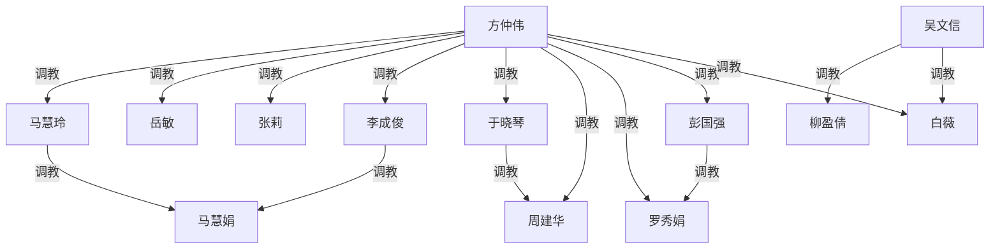

# 《疼爱》续写总大纲

## 总体规划

- **先分线扩展，后双线交汇**：先分别把**方仲伟线**与**白薇线**各自做实、做透，再借原书现成的人物关系网（高中同班同学、市文化局、市教育局、马锐杰朋友圈）自然汇合。
- **人物与原书衔接校准**：
  - 高中同班同学（李成俊数学班）：方仲伟、马慧娟、白薇、班长樊庆。
  - 原书第 3 卷末尾（4990 行）**文化宫之夜**，马慧玲亲口立誓「女儿也要为爸爸找很多的女人来供爸爸玩耍」，作为**方仲伟走向有秩序多偶的开端**。
  - 原书第 4 卷中，吴文信已帮白薇从涪城调回江城某职校任图书管理员，并送入艺术学院进修两年拿大专文凭；吴文信本人与马锐杰亦是打篮球结交的铁哥们。

---

## 一、方仲伟线

### 阶段 1：储蓄所时期（21–22 岁，单身，暂不碰性）

- **落点**：插在第 3 卷 `## 方仲伟与张莉` 开头——紧接女下属建言「扇耳光太丢脸、改打屁股」之后、「一年后升任信贷科副科长」之前。
- **原则**：全程**不碰性**，只走体罚（扇耳光、脱裤子打光屁股、罚跪）、羞辱与立规矩，完整保留原书「在鲜花丛中也能洁身自好」「张莉为首个同床女人」设定。
- **背景铺垫**：
  - 储蓄所 6 名 20 来岁女员工：4 名单身（含会计 **岳敏**，全程旁观打下手、被方仲伟兜住多取钱的责任事故，埋下崇拜与接任所长伏笔），2 名已婚（A、B 两户）。
  - 江城与银行工会转发「维护妇女权益、反对家庭暴力、创建文明家庭」宣传文件，成为日后反制外人的工具箱雏形。

#### 第一节：于晓琴 × 周建华（A 户：女强男弱，像揍老婆一样揍窝囊老公）

- **人物**：于晓琴（25 岁，柜员，在所里怕方仲伟、在家里骑在老公头上）；周建华（27 岁，国营小厂会计/库管，瘦小老实、包揽家务）。
- **经过**：于晓琴头天在所里出差错挨了罚，憋火回家撒在老公头上；次日睡过头耽误重要会议/大客户，方仲伟顶上摆平后把所里交岳敏照看，直接登门家访。进门撞破于晓琴正甩锅训老公，先当面拆穿她在单位挨打的乖顺样、抽耳光罚跪；见周建华窝囊求情，怒火烧到男的身上，**像揍女人、揍老婆一样扒裤子抽耳光、抽光屁股**，夫妻俩屁股打肿、并排光屁股跪地报数认错。
- **余波**：方仲伟走后，关起门家里**还是于晓琴说了算**，在所里受了气照常回家打骂周建华出气；周建华不敢声张告状；平时一有楼道脚步声或单位风声以为方仲伟突击家访，两口子就吓得手忙脚乱伪装男主外女主内。

#### 第二节：罗秀娟 × 彭国强（B 户：外强中干「强势老公」，借反家暴反咬一口）

- **人物**：罗秀娟（24 岁，出纳，爱打扮虚荣，因对客户态度差挨过耳光，且有小错账被方仲伟压下）；彭国强（28 岁，街道公司/跑运输，大男子主义重但**外强中干**）。
- **经过**：罗秀娟带脸伤回家，彭国强不敢惹干部子弟＋银行领导，又怕断老婆铁饭碗，在家大骂罗秀娟「不检点」关门毒打。次日罗秀娟带伤上班被方仲伟审出实情。方仲伟当晚揣上「反家暴、创建文明家庭」通知登门**反咬一口**：「老子在单位打她是执行组织纪律、替她兜错账保铁饭碗；你不敢找老子理论，关门拿女人撒气就是顶风家暴，明天交你单位和妇联！」彭国强瞬间怂了求私了。方仲伟专门问清罗秀娟平时怎么挨打，**用彭国强打老婆的同一件家伙、同一个姿势原样把彭国强狠揍一顿**，逼写保证书。顺水推舟把所里违纪惩罚改为**关门打屁股、罚跪**，既立威又不留明伤。
- **余波**：方仲伟走后，彭国强骨子里依然大男子主义，罗秀娟不敢告状，但彭国强**再也不敢在她身上打出痕迹**；偶尔失手打出青紫印子，夫妻俩反而一起紧张得要命，忙着热敷遮掩、找借口请假，生怕方仲伟看出来再上门「整治家暴」。

---

### 阶段 2：婚前翁婿谈判与多偶开端（22–23 岁，衔接原书）

- **补写原书空白——马锐杰 × 方仲伟翁婿谈判**（插在第 3 卷 4894 行「哪天把他找来，我与他谈谈」之后）：
  1. **下马威**：马家客厅（支开崔梦丹和马慧婷），马锐杰拿大女儿告状的「花心旧账」和婚前同居晚归敲打方仲伟；
  2. **亮清白与分量**：方仲伟不怂不狡辩，坦承前女友已一刀切断干净，顺手点出自己在工行信贷科的前程、已帮大姐夫李成俊拍板办贷款、日后三叔饭馆与亲戚小厂资金周转都是一句话的事；
  3. **大男人同频共振与交权**：马锐杰试探他「脾气爆、爱打女人」，方仲伟直说不装软蛋也不乱打，认「女人不立规矩不行」，顺手一个眼神让屋角平时最倔的马慧玲乖乖小跑添茶——马锐杰看在眼里，暗自佩服，正式交出女儿管教权；
  4. **老丈人底线警告（埋婚初忌惮伏笔）**：马锐杰放狠话「婚后要是敢在外面胡来、让女儿没脸，老子翻脸不认女婿」。
- **文化宫之夜（原书 4990 行）**：马慧玲亲口表忠心「女儿也要为爸爸找很多的女人来供爸爸玩耍」，为婚后走向有秩序的多偶埋下正室承诺；随后完婚。

---

### 阶段 3：婚初忌惮期 → 升迁后不再忌惮马家，岳敏＆张莉旧情复燃（约 24–25 岁）

- **婚初忌惮期**：
  - 婚前断干净很大一部分原因就是**忌惮门当户对的马家与大厂保卫部长马锐杰**；
  - 婚后张莉、岳敏虽对「爸爸」念念不忘，岳敏（同银行储蓄所所长）借工作汇报频频试探、张莉（市教育局）也找由头联系，但方仲伟在未彻底坐稳高层位置前克制冷静，暂吊着不动，稳住口碑与老丈人。
- **坐稳位置／升任副行长后（不再忌惮马家）**：
  - 方仲伟一路升迁坐稳实权（支行/市行副行长），马家三叔饭馆、崔梦丹亲戚小厂、李成俊生意反过来都离不开他的银行口子，他对马家的忌惮彻底消解；
  - **旧情复燃与正室立规**：方仲伟松口后，憋了许久的**岳敏、张莉很快重新贴上来**。马慧玲最初因昔日情敌归来吃醋闹事，被方仲伟按住拿**文化宫誓言**打服，同时顺势立下**「方家多偶规矩」**——明面上马慧玲是唯一正牌夫人，暗地里岳敏、张莉想重回「爸爸」脚边，须先跪认小三岁的马慧玲当正室大管家、听她管束；
  - **额外红利**：岳敏在银行系统继续替方仲伟掌管储蓄所旧部（含于晓琴、罗秀娟两户的长期威慑）；张莉稳占**市教育局**暗线，为日后交汇白薇线埋好棋子。

---

### 阶段 4：马慧娟 × 李成俊（B → C 完整闭环，终极升级版「治家暴」）

- **前置暗雷**：婚前同学聚会后方仲伟帮李成俊批的第一笔贷款，因李成俊缺抵押物，方仲伟表面以连襟情分「特事特办、打擦边球」放款——顺时是人情，爆雷时就是**违规套贷／骗贷的刑事把柄**。
- **B-1（愚忠硬扛，暂不破身）**：
  - 李成俊下海扩张资金链断裂、面临抽贷危机，拉不下脸求昔日挨过自己手板的学生，推老婆**马慧娟**以亲姐妹/老同学名义去银行说情续贷；
  - 方仲伟翻起高中被李成俊打手板、被学习委员马慧娟催作业挨耳光的旧账，拿签字卡住她。马慧娟出于对丈夫的**愚忠**，甘愿忍受罚跪求情、扇耳光、挨手板和羞辱，但方仲伟此阶段**暂不肏她**，让她自以为守住了底线。
- **B-2（妹妹破除敬畏、反手管教姐姐，击穿愚忠）**：
  - **马慧玲婚初隐秘自卑**：婚初她仍敬畏端庄的大姐和凶悍的姐夫，两家走动时死命藏伤，生怕被姐姐应验「方仲伟不是好人、跟了他掉价」的预言；
  - **撞破与滤镜粉碎**：马慧玲撞破亲姐为救李成俊跪在自己老公脚边，最初吃醋大闹，被方仲伟再立一次威打服后，对姐姐姐夫维持十几年的敬畏瞬间碎裂；
  - **倒转「姐教妹」＋句句诛心**：方仲伟把尚方宝剑交给更懂自己规矩的马慧玲，让她替自己教姐姐守方家规矩（讨打、自称贱女儿、跪砖照镜、察言观色）。马慧玲借题发挥，**拿姐姐当年骂方仲伟的话原封不动反踩李成俊**：离开体制没眼光、没本事推老婆出来求人、老婆在妹夫这儿受委屈连硬都硬不起来真窝囊！这几刀精准扎在事实七寸上，彻底动摇马慧娟十几年来对李成俊的愚忠。
- **B-3（最后防线失守，彻底办了）**：
  - 续贷关键节点，马慧娟在妹妹管教下体面剥尽、对丈夫滤镜破碎，最终心理防线崩塌，被方仲伟彻底办了。
- **引爆点（眼神疏离 → 丈夫失手打出明伤）**：
  - 失身回家的马慧娟虽身体习惯顺从，但心里不再像过去那样死心塌地；本就疑神疑鬼、憋一肚子窝囊气的李成俊敏锐察觉她的疏离和走神，醋火攻心家暴失手，**打坏了马慧娟遮不住的脸或手（明伤）**。
- **滑入 C 阶段（升级版「治家暴」＋ 贷款死穴 ＋ 高中手板债）**：
  - 伤情暴露（文化局/银行或被马慧玲撞见），方仲伟带着**贷后违规检查材料**杀上李家门，三箭齐发钉死李成俊：
    1. **道义反咬（呼应罗秀娟线的终极升级版）**：以妹夫替大姐出头＋反家暴名义痛斥他「没本事靠老婆低声下气跑贷款，关门往脸上手上往死里打」；
    2. **现实死穴**：亮出擦边球贷款违规材料（不压下去三天移交经侦，坐牢连累李润泉、兰兰，捅到马锐杰那儿颜面扫地），彻底封死李成俊掀桌拼命的退路；
    3. **讨回旧账**：当着马慧娟的面，拿出教鞭/戒尺（或李家传家家法），逼昔日威风八面的数学老师**伸手挨学生抽手板、罚跪认错**。
  - **长期稳态**：傲骨折断后，李成俊彻底矮方仲伟一头；外人面前仍是老板，家里仍管着马慧娟，但只要方仲伟开口，夫妻俩只能老老实实配合，再不敢违逆。
- **老丈人马锐杰与崔梦丹**：暂留白待后续细化。

---

## 二、白薇线（独立扩展：紧接第 4 卷第 6746 行）

### 阶段 1：午饭桌暗流 → 彻底破身

- **无缝衔接第 6746 行**：白薇刚在卧室里被吴文信穿着五件泳衣皮带抽肿屁股、摸到高潮并主动亲吻，门外柳盈倩喊吃饭。
- **午饭桌猫鼠戏**：白薇强忍快破皮的臀痛硬坐木凳装没事，吴文信从容逗她；柳盈倩作为过来人一眼看出端倪，却因前两次多嘴挨打不敢发作，憋着酸气与恐慌。
- **主动破身**：趁柳盈倩带吴刚回娘家或值夜班的周末，白薇受虐瘾（前夫许虎昌时期养成的「不挨打无法高潮」）发作，故意找茬惹吴文信狠抽，在清醒状态下跪爬到脚边亲口求「爸爸」要了自己，正式从寄住表妹滑向地下二房。

### 阶段 2：「丁红撞见追求者」揭底 ＋ 华达贵宾卡风波

- **澄清与实情**：
  - 原书 6596 行寝室丢衣服、找吴文信要 1000 块钱**确系真被偷**，保持白薇人设不低俗；
  - 原书 6186 行**「丁红看见白薇和男的在街上搂抱」走方案 A**：确有一名艺校/校外年轻追求者缠着白薇，白薇一半贪玩虚荣、一半因为表姐夫给不了明面名分，私下收礼吃饭、偶尔用华达贵宾卡出入娱乐城。
- **吴文信占有欲爆发与大清算**：
  - 此前白薇未破身，吴文信还大度替她挡过柳盈倩质问；如今已是自己人，吴文信从华达熟人（刘平线）或偶然撞破实情后醋火大发，彻底收紧缰绳——没收贵宾卡、狠狠算总账重罚、定死每周行踪汇报规矩，把白薇那股仗宠耍滑的野气压死。

### 阶段 3：柳盈倩撞破越界 → 吴家表姐妹新秩序

- **视角反转**：呼应原书 5676 行白薇半夜顺门缝偷看表姐挨打那一幕——这回轮到**柳盈倩提前回家或起夜，顺门缝亲眼撞破白薇光身跪侍吴文信、挨抽交欢**。
- **摊牌与双女并跪**：柳盈倩气哭质问、与白薇撕破脸，甚至鼓起勇气顶撞吴文信；吴文信直接把表姐妹俩一起按在卧室扒光并排罚跪立威，摊牌定死吴家双女格局。
- **微妙权力差（刻意区别于方仲伟家）**：
  - 柳盈倩虽想端正室架子硬气起来，但夫妻十年早被吴文信驯得服服帖帖、骨子里硬气不起来，两女都归吴文信管；
  - 但存在一条关键制衡：**吴文信私下虽偏宠俏皮的白薇，可一旦白薇不敬表姐、或柳盈倩搬出正室身份和家规来压白薇，吴文信为了维护家序，反而会对白薇罚得更重！**

### 阶段 4：程思妍 × 黄超对照组 ＋ 毕业换工作契机

- **程思妍 × 黄超保留为对照组**（后期视机会卷入）：
  - 白薇拉着程思妍闯祸双双挨各自男人打，但在对比中白薇心里渐渐生出一根刺——市直机关副科长黄超虽打得狠，却给足程思妍正牌未婚妻名分、打完还心疼做红烧排骨；而自己只能在表姐眼皮底下当见不得光的地下情人，连女儿许欣都只能长寄外婆家。
- **现实出口**：艺术学院两年大专临近毕业，白薇想摆脱职校图书管理员这个没前途的闲职、换去江城更好的文化/教育单位并独立接回女儿；吴文信一则能力够不着市级好单位，二则潜意识不想白薇脱离掌控，这便自然推出了交汇口。

---

## 三、双线交汇路线图（白薇 × 马慧娟 × 方仲伟 × 吴文信）

1. **闺蜜重逢生疑**：
   - 白薇为换工作（或怀旧）找上在**市文化局**上班的高中死党**马慧娟**；
   - 白薇敏锐察觉，当年骄傲端庄、对李成俊死心塌地的马慧娟**整个人气质大变**——神情畏缩、一提妹夫方仲伟和妹妹马慧玲就本能发怯走神；白薇追问怎么回事，马慧娟因为害怕方仲伟死活不敢说（但言行破绽百出，后面会被白薇撞破/发现真相）。
2. **求职撞上副行长老同学**：
   - 换工作卡壳之际，白薇顺着马慧娟这条线（或高中同学关系）求到如今已是市行副行长、手里还攥着**市教育局（张莉）**和江城政商关系的昔日老同学**方仲伟**。
3. **脚踏两条船 → 双雄正面分高下**：
   - **双船拉扯期**：白薇为了前程、女儿和隐秘刺激，先**同时周旋在表姐夫吴文信与老同学方仲伟之间**——两边都是大男子主义狠角色，两边都要查行踪、两边都在她屁股上留印子，白薇战战兢兢两边藏伤、撒谎圆场；
   - **终极摊牌**：纸终究包不住火（印子穿帮／行程撞车／经由马锐杰与吴文信的铁哥们朋友圈露馅），**吴文信（长辈铁哥们、企业中层）与方仲伟（马锐杰二女婿、市行实权副行长）正面碰上，最终分出高下！**

---

## 全盘调教权力演进图（规划）

前期方仲伟线与吴文信线各自独立推进：方仲伟先在储蓄所压服于晓琴、罗秀娟两户，婚后升官坐稳不再忌惮马家，先收回岳敏、张莉并立马慧玲为正室大管家，再通过 B→C 闭环经由马慧玲管教马慧娟并最终折断李成俊傲骨；吴文信线在表姐妹新秩序下掌控柳盈倩与白薇。后期双线于白薇处交汇，白薇先脚踏两条船，最终吴文信与方仲伟分出高下。
