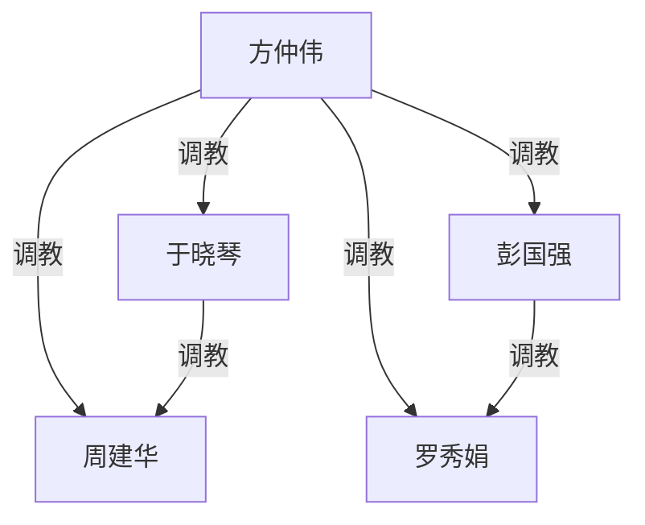

# 《疼爱》续写大纲

## 总体规划

- **先分线扩展，后预留交汇**：分别扩展**方仲伟线**与**白薇线**，暂不提前汇合。
- **日后交汇暗扣（原书现成设定）**：方仲伟与白薇原为高中同班同学（同在李成俊班上，均与马慧娟同班）；白薇急需从涪城调回江城方便女儿许欣读书，方仲伟手里握着工商银行信贷与人脉资源，且马慧玲在第 3 卷末尾亲口答应过「为爸爸找很多女人」。

---

## 一、方仲伟线（当前主攻：第 3 卷储蓄所时期）

### 插入位置与衔接原则

- **落点**：插在第 3 卷 `## 方仲伟与张莉` 开头的储蓄所段落中——紧接一女下属建言「方哥，扇耳光实在太丢脸了，能不能改打屁股呢？」之后、方仲伟「一年后升任信贷科副科长」之前。
- **尺度原则**：储蓄所这一年**暂不碰性**，全程只走体罚（扇耳光、脱裤子打光屁股、罚跪）、羞辱与规矩压制。
  - 既完整解释原文「任随六女之一向上告状，方仲伟都会吃不了兜着走，但没人这样做」；
  - 又完全贴合原文「在鲜花丛中也能洁身自好」以及张莉是他第一个同床女人的设定，留出他升信贷科开荤后再回头升级的空间。
- **背景铺垫**：
  - 原文储蓄所有 6 名 20 来岁女员工：4 名单身（含会计 **岳敏**，可作旁观／帮手，自然铺垫她日后崇拜方仲伟并接任所长），2 名已婚（即 A、B 两户）。
  - 江城市里与银行工会正在转发「维护妇女权益、反对家庭暴力、创建文明家庭」的宣传文件，正好给方仲伟提供了反咬 B 家老公的大义名分。

### 第一节：于晓琴 × 周建华（A 家：女强男弱，像揍老婆一样揍窝囊老公）

- **人物**：
  - **于晓琴**（25 岁，储蓄所柜员）：嘴利心傲，在所里怕方仲伟，在家里骑在丈夫头上颐指气使。
  - **周建华**（27 岁，国营小厂会计／库管）：瘦小老实、性子软，包揽家务，挨老婆骂只会低头赔笑。
- **起因**：
  - 于晓琴头天在所里出业务差错，被方仲伟按规矩严厉收拾，憋了一肚子火回家全撒在周建华身上；
  - 次日早上有重要会议／大客户业务，于晓琴在家睡过头没按点到岗。方仲伟自己顶上去摆平后，把所里交给岳敏照看，压着火气直接登门「家访」。
- **家访与双双挨揍**：
  - 还没进门就听见于晓琴在屋里训斥周建华，把睡过头全怪到老公没叫醒她头上；
  - 门一开，于晓琴看见方仲伟瞬间腿软失色，被方仲伟当着周建华的面揭穿平时在单位立正挨耳光、趴桌挨打的乖顺样，先按住扇耳光、逼跪地板，嘴硬甩锅老公时又被加罚；
  - 方仲伟见周建华缩在一边大气不敢出、反倒卑微替老婆求情，怒火烧到男的身上——最看不惯这种「男的不像男、女的不像女」的窝囊家庭；
  - **像揍女人、揍老婆一样揍周建华**：彻底撕掉他的男人体面，命令他脱裤子趴好，像教训不听话的小媳妇一样抽耳光、板子／皮带狠抽光屁股，夫妻俩屁股都打肿，并排光着屁股跪在客厅反省、报数认错、听方仲伟立规矩。
- **方仲伟走后的日常余波**：
  - 关起门来，家里实际上**还是于晓琴说了算**——她在单位受了气、挨了方仲伟的打，回家照样拿周建华出气，打骂照旧；
  - **周建华不敢再声张，更不敢告状**：心里明白真闹到方仲伟耳朵里，只会再引来一顿更丢人的双份毒打；
  - **防家访伪装**：平时一听见楼道脚步声或单位风声，以为方仲伟要突击家访，两口子立刻吓得手忙脚乱装样子——藏起搓衣板、推周建华坐上主位装一家之主、于晓琴端茶倒水装贤妻，战战兢兢生怕露馅。

### 第二节：罗秀娟 × 彭国强（B 家：外强中干「强势老公」，借反家暴反咬一口）

- **人物**：
  - **罗秀娟**（24 岁，储蓄所出纳）：爱打扮、性子带点虚荣，因对客户态度差被举报，在所里挨过方仲伟耳光；手里还有一笔小差错被方仲伟压下，饭碗攥在对方手里。
  - **彭国强**（28 岁，街道公司／跑运输职员）：在家里大男子主义重、脾气横，实则**外强中干**，专挑软柿子捏。
- **起因**：
  - 罗秀娟顶着微肿的脸回家，彭国强盘问出是男所长打的；
  - 彭国强一打听方仲伟是干部子弟、行里重点培养对象，又不敢断老婆的工行铁饭碗，压根不敢找方仲伟算账；
  - 怂火没处撒，彭国强转头在家大骂罗秀娟「不检点」「骚里骚气惹是非」，关起门来狠揍老婆一顿。
- **反家暴家访与原样奉还**：
  - 第二天罗秀娟眼角带青、走路发僵去上班，被方仲伟一眼看穿，叫进里间审出是回家挨了老公的打；
  - 方仲伟当晚揣上行里刚发的**「反对家庭暴力、创建文明家庭」**宣传通知，让罗秀娟带路直接上门家访，彻底**反咬一口**：
    - 彭国强强撑着顶一句「方所长你不也在单位打她？」；
    - 方仲伟理直气壮压死他：**「老子在单位打她，是执行组织纪律、替她兜住错账保铁饭碗；你不敢找老子理论，关起门拿女人撒气，这就是顶风作案搞家暴！明天我就把材料交到你单位和街道妇联！」**
  - 彭国强外强中干，听说要报单位和妇联瞬间怂了求私了。方仲伟当场**专门审问罗秀娟：「平时在家他怎么打你的？用啥家伙、让你咋个姿势跪？」**
  - 罗秀娟不敢瞒，一五一十交代完；方仲伟就当着罗秀娟的面，**用彭国强平时打老婆的同一套方法、同一件家伙、同一个姿势，原封不动把彭国强狠揍一顿**，逼他在老婆面前痛哭求饶、写下不再家暴的保证书。
- **顺水推舟立所规**：
  - 经此一事，方仲伟才松口采纳先前女下属的提议，把所里违纪惩罚从扇耳光改成**关门打屁股、罚跪**，既立威又不留明伤、少惹麻烦；
  - 所里六女彻底服帖、零举报，业绩大涨，行里以为他治理有方、还妥善化解职工家庭矛盾，顺理成章接回原文「一年后升任信贷科副科长」。
- **方仲伟走后的日常余波**：
  - 彭国强骨子里**依然大男子主义**，在家里还是摆当家作主的架子，罗秀娟也习惯了，不敢真拿他去向方仲伟告状；
  - 但彭国强**再也不敢在罗秀娟身上打出痕迹**（不敢扇肿脸、不敢往外露处抽）；
  - 偶尔火气上头、**不小心打出了青紫或印子，夫妻俩反而一起紧张得要命**——一个怕方仲伟看出来再杀上门「整治家暴」，一个怕连累自己男人再当面出丑，两人一块儿热敷、涂药、遮掩、找借口请假，提心吊胆等印子消掉。

### 储蓄所两户权力结构

最高位是方仲伟。两户关起门来仍保留原本的家庭强弱格局（于晓琴压周建华、彭国强压罗秀娟），但头顶都压着方仲伟的管教与家访威慑。

### 方仲伟线后续预留（升职／婚后阶段）

- 岳敏接任储蓄所所长后，承接方仲伟的管教路子，替他盯紧所里；
- 方仲伟升信贷科开荤、娶马慧玲后，可展开婚后多女格局（马慧玲兑现「为爸爸找女人」的承诺，回头再升级已婚下属线，或处理与岳父马锐杰、连襟李成俊的关系）。

---

## 二、白薇线（暂缓，独立扩展：紧接第 4 卷末尾）

- **落点**：紧接原书最终句——试完五件泳衣挨抽、摸出水并吻上吴文信，门外柳盈倩喊吃饭。
- **推进骨架**：
  1. **饭桌暗战与彻底破身**：白薇强忍臀痛应付饭桌上的柳盈倩与吴刚；随后趁柳盈倩带儿子回娘家，白薇受虐瘾发作故意讨打，在理性状态下亲口求吴文信要了自己，跨过最后一道防线；
  2. **华达贵宾卡与校外追求者暗雷**：收回原文「丁红看见白薇和男的在街上搂抱」的伏笔，结合艺校室友 **程思妍（× 黄超）** 作对照线，引爆吴文信吃醋重罚、全面管死白薇行踪；
  3. **表姐妹摊牌与吴家新秩序**：柳盈倩撞破两人越界、醋意发作顶嘴，反被吴文信连带收拾，立下表姐妹同跪、互相监督的新规矩；
  4. **预留交汇暗扣**：白薇最挂心的「从涪城调回江城、接回女儿许欣」被吴文信拖着未办利索，为日后重逢老同学方仲伟埋下引子。
